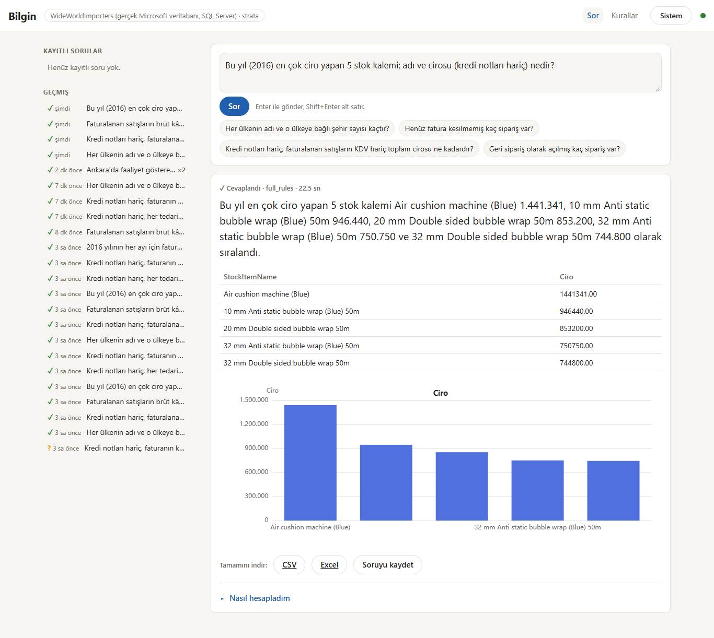
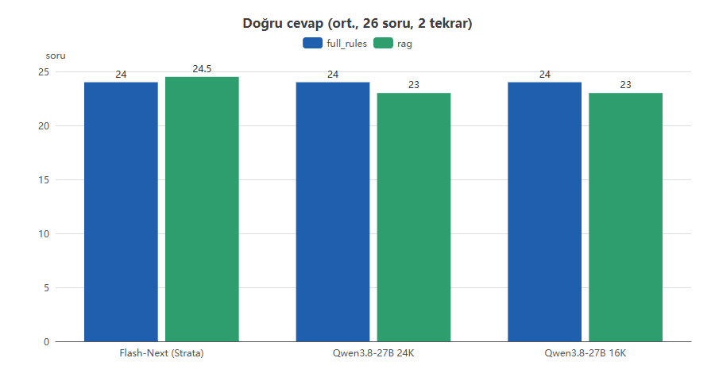

# Bilgin

**A local-first AI data analyst for ERP databases.** Ask a question in Turkish, get a verified answer from your own
SQL Server — as a sentence, a table and a chart. The model, the database and the UI all run on your machine; no
question and no row ever leaves it.

> *Bilgin* (Turkish): "learned, wise" — and also "your knowledge". Your data stays yours.



---

## Why

ERP data sits where the people who need it can't reach it: a report becomes an IT ticket, the ticket becomes days.
Generic "chat with your data" tools stumble twice — they ship the data to a cloud LLM, and they let the model do
the math. Bilgin is built around the opposite rules:

| Principle | What it means |
|---|---|
| **Data stays home** | Model, database and UI run on-prem. No cloud LLM API. |
| **SQL is the single source of truth** | Every number is computed by the database. The model never produces a number; every number in the answer sentence is checked against the result by code. |
| **The model is the language layer** | It understands the question, writes the SQL and narrates the result. It does not sum, average or divide. |
| **Security lives in the database** | The real boundary is a read-only SQL login with column-level `DENY`. The in-app checks are a second layer. |

## Results

Measured on Microsoft's real **WideWorldImporters** database (SQL Server, read-only login), 26 business questions
with traps, 2 repeats per cell:

| Model | Mode | Correct (avg) | min–max | s / question | Peak prompt |
|---|---|---:|---:|---:|---:|
| Qwen3.8-Flash-Next (256K) | `full_rules` | 24.0 / 26 | 24–24 | 4.3 | 9.1K |
| Qwen3.8-Flash-Next (256K) | `rag` | 24.5 / 26 | 24–25 | 9.9 | 6.8K |
| Qwen3.8-27B, 24K context | `full_rules` | 24.0 / 26 | 24–24 | 4.4 | 9.1K |
| Qwen3.8-27B, 16K context | `full_rules` | 24.0 / 26 | 24–24 | 4.1 | 9.1K |
| Qwen3.8-27B, 16K context | `rag` | 23.0 / 26 | 23–23 | 7.7 | 5.3K |

- All 7 trap questions (credit notes, unbilled orders, back orders, late deliveries, …) are answered correctly.
- The two misses (Q01, Q25) are the same for every model and both are **ambiguous questions**, not SQL errors.
- A 27B at 4-bit with a 16K window — fits a 24 GB GPU — matches the large dev model in `full_rules` mode.

Full write-up: [docs/GERCEK-WWI-TEST.md](docs/GERCEK-WWI-TEST.md) · technical overview:
[docs/BILGIN-TEKNIK-DOKUMAN.md](docs/BILGIN-TEKNIK-DOKUMAN.md) (both in Turkish).



## How it works

```
Question (Turkish)
  -> Agent loop (local LLM, tool calls)
       tools: search_schema · get_table_details · find_join_path · sample_values · search_rules
              · run_sql · submit_sql · ask_clarification
  -> Policy (sqlglot AST: single SELECT, table allowlist, TOP cap, PII filter/order ban, closed columns)
  -> Executor (read-only connection, row + time budget) -> PII masking -> audit log
  -> Report: chart choice (code) + facts (code) + Turkish narration (LLM) + number guard (code)
  -> Web UI / CLI / JSON API
```

- **Context modes.** `full_rules` gives the model the whole schema plus the business rules; `rag` retrieves only the
  relevant tables with hybrid search (dense + BM25, fused with RRF) and a foreign-key join graph; `auto` picks one
  by token budget.
- **Business-rule layer.** Company-specific definitions ("ciro", "net satış", "geciken teslimat") live in a rules
  file: definition, SQL hint, tables and verification markers. Eval checks that the rule actually made it into the
  SQL.
- **Number guard.** Every number in the narrated sentence must appear in the result or in the code-computed facts;
  technical column names are rejected too. A failing sentence is retried once, then replaced by a template built in
  code. An unverified number never reaches the user.
- **Clarification instead of guessing.** If a question has two readings, the model can return a
  "Netleştirelim" card with options instead of an answer.
- **Schema onboarding.** Introspect a live database, import a customer's Excel schema map (the LLM proposes the
  column mapping, code converts), diff and merge the two.

## Security

| Layer | What it does |
|---|---|
| Read-only SQL login | `SELECT` on allowlisted tables only, column-level `DENY` on PII/closed columns, `DENY EXECUTE`, `DENY VIEW DEFINITION`; the connection is forced to `ApplicationIntent=ReadOnly`. Generated by `make-login-script`. |
| Policy (sqlglot) | Single `SELECT`, no writes/DDL, no system schemas, `TOP` cap, no filtering/sorting on PII columns, no `OPENROWSET`, cross-database or linked-server access. |
| PII masking | Eight classes (national ID, tax ID, IBAN, phone, e-mail, address, salary, person name), traced through expressions and CTEs; aggregates over single-person groups are masked too. |
| Audit log | Every query, its origin and the *names* of masked columns — never the values. |

Connection strings live only in environment variables, never in code, config or the repo.

## Quick start

Requirements: Python 3.11+, Node 20+ (only to build the UI), and an OpenAI-compatible local LLM endpoint with tool
calling (llama.cpp, vLLM, Unsloth Studio, …) for real answers.

```bash
# 1. install
python -m venv .venv
.venv/Scripts/activate            # Linux/macOS: source .venv/bin/activate
pip install -e . pytest httpx

# 2. build the WideWorldImporters SQLite test database (the default dataset)
python -m nl2sql build-db

# 3. try it without a model — the fake LLM replays the golden SQL
python -m nl2sql ask --llm fake --mode full_rules "Henüz fatura kesilmemiş kaç sipariş var?"
python -m nl2sql eval --llm fake --mode full_rules       # Skor: 26/26

# 4. point it at your local model and ask for real
export NL2SQL_LLM_BASE_URL=http://127.0.0.1:8080/v1      # PowerShell: $env:NL2SQL_LLM_BASE_URL = "..."
python -m nl2sql ask "Bu yıl en çok ciro yapan 5 stok kalemi hangisi?"

# 5. the web UI
npm --prefix web ci && npm --prefix web run build
python -m nl2sql serve                                    # http://127.0.0.1:8777
```

For `rag` mode, build the search index first (`python -m nl2sql build-index`); it needs an embedding endpoint
(`NL2SQL_EMBED_BASE_URL`, any OpenAI-compatible `/v1/embeddings`).

## Configuration

| Variable | Purpose | Default |
|---|---|---|
| `NL2SQL_LLM_BASE_URL` / `_MODEL` / `_API_KEY` | Chat endpoint (OpenAI-compatible, tool calling) | `http://127.0.0.1:8080/v1` |
| `NL2SQL_EMBED_BASE_URL` / `_MODEL` / `_API_KEY` | Embedding endpoint for `rag` | `http://127.0.0.1:8891/v1` |
| `NL2SQL_BACKEND` | `sqlite` (test DB) or `mssql` (real SQL Server) | `sqlite` |
| `NL2SQL_MSSQL_CONN` | ODBC connection string of the **read-only** login | — |
| `NL2SQL_DATASETS_DIR` | Folder holding the dataset definitions | `datasets/` |

Model profiles (endpoint, context budget, max output) live in [`config/models.json`](config/models.json) and are
selected with `--model <profile>`. All other tunables sit at the top of [`nl2sql/config.py`](nl2sql/config.py).

## Commands

| Command | What it does |
|---|---|
| `build-db` | Builds the dataset's SQLite DB and its T-SQL build script |
| `build-index` | Builds the hybrid search index over schema + rules |
| `ask` | Answers one question: `ask "<question>"` (`--json` for the API payload, `--mode`, `--model`, `--choice`) |
| `serve` | Web UI + JSON API on loopback |
| `eval` | Runs the golden set; `--compare` runs modes × models, `--repeat N` measures noise |
| `eval-retrieval` | Retrieval recall@k on the golden set, no LLM |
| `introspect` / `import-map` / `diff-map` / `merge-map` | Schema onboarding from a live DB and an Excel map |
| `make-login-script` | Generates the read-only SQL Server login script with column-level `DENY` |

Every command takes `--dataset <name>`; `python -m nl2sql <command> --help` lists the options. The ones you will
use most:

| Flag | Where | Meaning |
|---|---|---|
| `--llm` | `ask`, `eval`, `serve`, `import-map` | `openai` (the configured endpoint) or `fake` (replays golden SQL, no model) |
| `--mode` | `ask`, `eval` | `full`, `full_rules`, `rag` or `--mode auto` (picks by the model's token budget) |
| `--model` / `--models-file` | `ask`, `eval`, `serve` | A profile from `config/models.json` |
| `--compare` | `eval` | Runs every mode on the same questions and writes one report ending in a `Karar:` (verdict) line |
| `--models A,B` / `--modes` | `eval` | With `--compare`: model × mode grid |
| `--repeat` | `eval` | With `--compare`: runs each cell N times and reports min–max |
| `--fresh` | `eval` | With `--compare`: re-runs cells that already have a report |
| `--only` / `--tag` | `eval` | Only these question ids / only questions with these tags |
| `--schema` | `eval` | Which schema the model sees: a file, `full` or `skeleton` (measures what descriptions add) |
| `--seed` | `build-db` | Generator seed (default: the dataset's own, 42) |
| `--embed` | `build-index`, `eval-retrieval` | Embedder: `openai` (the endpoint) or `fake` / `fake:<dim>` for tests |
| `--k` | `eval-retrieval` | Tables retrieved per question (default 5) |
| `--accept` / `--out` | `import-map`, `introspect`, `merge-map` | Apply the proposed mapping and write the schema / output file |
| `--excel` / `--db` | `diff-map`, `merge-map` | The Excel-derived schema and the live database to compare or merge |
| `--login` | `make-login-script` | Login and user name of the read-only account (default `nl2sql_ro`) |

### Embedding server

`rag` mode and `build-index` call `NL2SQL_EMBED_BASE_URL` (default `http://127.0.0.1:8891/v1`) with
`NL2SQL_EMBED_MODEL` and `NL2SQL_EMBED_API_KEY`. Any llama.cpp `llama-server --embedding` works. Development used
**EmbeddingGemma-300M** on CPU (Gemma terms); the product target is **bge-m3** (MIT) — measure it with
`eval-retrieval --embed openai --embed-model bge-m3` before switching.

### Reviewing the golden questions

A score says what the SQL computed, not whether the question meant that. `python -m eval.review --dataset wwi`
writes `datasets/wwi/REVIEW.md`: every question with its tags, rules, golden SQL and the first rows of the
independent Python reference, each with an unchecked "niyet doğru" box for a human to tick.

## Datasets

A dataset is a folder with a `dataset.json`: schema, business rules, join-graph profile, golden questions, traps,
a builder for the test DB and an independent Python reference that computes every golden answer without SQL.

| Dataset | What it is |
|---|---|
| [`datasets/wwi`](datasets/wwi) (default) | WideWorldImporters-shaped SQLite test DB, generated deterministically; 26 golden questions + traps |
| [`real_datasets/wwi_real`](real_datasets/wwi_real) | The restored real WideWorldImporters on SQL Server (`NL2SQL_DATASETS_DIR=real_datasets`, `NL2SQL_BACKEND=mssql`) |

Connecting to your own ERP: restore a **copy** of the database, create the read-only login with
`make-login-script`, read the schema with `introspect`, enrich it with an Excel map, write the business rules and a
handful of golden questions — then run `eval` before anyone trusts an answer.

## Repository layout

```
nl2sql/          Python package (CLI: python -m nl2sql)
  agent/         agent loop, tools, prompts, LLM client, fake LLM
  policy/        sqlglot policy + PII rules
  engine/        SQLite / SQL Server executors, budgets, login script
  index/         embeddings, BM25, hybrid search, table summaries
  graph/         join graph from foreign keys + ERP profile
  schema_map/    schema docs, introspection, Excel import, diff/merge, rules
  report/        chart choice, facts, narration, number guard
  eval/          golden runner, compare, metrics, reports
  app/ web/      ask session + FastAPI app
web/             React + ECharts UI (built into nl2sql/web/static)
datasets/        dataset definitions
real_datasets/   datasets that live on a real SQL Server
config/          model profiles
tests/           pytest suite
docs/            Turkish technical document and the real-database test report
```

## Development

```bash
python -m pytest -q          # 1761 passed
npm --prefix web test        # 136 passed
```

The project was built with a "cloud brain, local hands" loop: a cloud model wrote the plan and reviewed each
milestone, a local Qwen model implemented and tested every task, and a deterministic orchestrator ran acceptance
commands, test-weakening guards and visual checks in between.

## Status and next steps

- Rewrite the two ambiguous golden questions (Q01, Q25) into single-reading questions — target 26/26.
- Run on a filled ERP demo database with 20–30 real user questions.
- More repeats for the 27B, and a lower-bit quant that fits 16 GB VRAM.
- License review of the LLM and the embedding model before any commercial deployment.

## License

Not chosen yet — private repository, all rights reserved.
