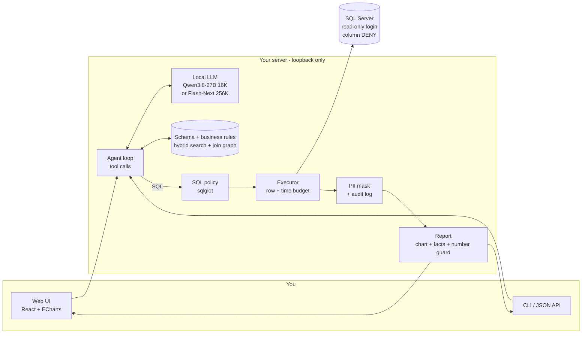
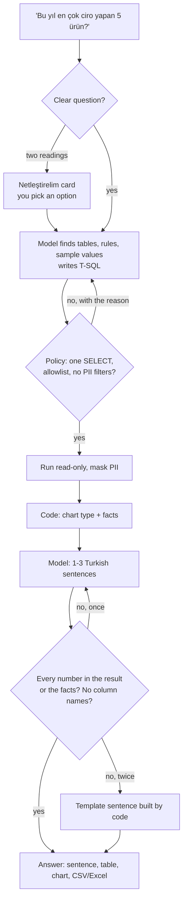

<div align="center">

# 📚 Bilgin

**A local-first AI data analyst for ERP databases: ask in Turkish, get a verified answer from your own SQL Server.**

*Bilgin means "learned, wise" in Turkish - and also "your knowledge". Your data stays yours.*


</div>

> **🇹🇷 Türkçe özet:** Bilgin, ERP kullanıcısının SQL bilmeden Türkçe soru sorup kendi veritabanından cevap
> almasını sağlayan, tamamen yerel çalışan bir yapay zekâ veri analistidir. Soruyu T-SQL'e çevirir, sorguyu
> **salt-okunur** bir girişle çalıştırır, sonucu tablo, grafik ve doğal Türkçe bir cümleyle gösterir. Model, veritabanı
> ve arayüz müşterinin makinesinde kalır; ne veri ne soru buluta gider. Her sayıyı veritabanı hesaplar, model sayı
> üretmez; cevap cümlesindeki her sayıyı kod doğrular. Soru iki türlü okunabiliyorsa tahmin etmez, seçenek sunar.
> Microsoft'un gerçek WideWorldImporters veritabanında 26 iş sorusunun 24'ünü doğru cevaplıyor; 24 GB'lık bir ekran
> kartına sığan Qwen3.8-27B (16K bağlam) ile bile, soru başına ~4 saniyede. Ayrıntılar:
> [teknik doküman](docs/BILGIN-TEKNIK-DOKUMAN.md) · [gerçek veritabanı testi](docs/GERCEK-WWI-TEST.md).

<p align="center">
  
  
</p>
<p align="center"><sub>Real WideWorldImporters on SQL Server: the top 5 stock items by revenue (Flash-Next) and revenue net of VAT and credit notes (Qwen3.8-27B, 16K context). Sentences, tables and charts exactly as the UI returned them.</sub></p>

---

## What it is

- **A data analyst that lives on your server.** Ask *"Bu yıl en çok ciro yapan 5 ürün hangisi?"* and get a Turkish
  sentence, the result table, a chart and a CSV/Excel download. No SQL, no IT ticket, no cloud.
- **Numbers you can trust.** The model writes the SQL and narrates the result; it never computes a number. Every
  number in the sentence must appear in the result or in facts computed by code, otherwise the sentence is rejected.
- **A business-rule layer.** Your definitions of "ciro", "net satış" or "geciken teslimat" live in a rules file the
  model reads and the eval checks - so "revenue" means VAT excluded and credit notes subtracted, every time.
- **Asks instead of guessing.** When a question has two readings, Bilgin shows a "Netleştirelim" card with options.
- **Security in the database, not in a prompt.** A read-only SQL login with column-level `DENY` is the real
  boundary; the SQL policy, PII masking and audit log sit on top of it.
- **Measured, not demoed.** Every dataset carries golden questions with traps and an independent Python reference;
  `eval --compare` runs models × modes × repeats and writes the report.

## What you need

| | |
|---|---|
| **Graphics card** | **24 GB VRAM** for the recommended setup (Qwen3.8-27B, 4-bit, 16K context). Tested on an RTX 5090 32 GB. |
| **LLM server** | Any OpenAI-compatible endpoint with tool calling: llama.cpp, vLLM, Unsloth Studio, ... |
| **Database** | SQL Server (a **copy** of the ERP database, never the live one) and a login you can grant `SELECT` and `DENY` on. A SQLite test database is built in for trying it out. |
| **System** | Python 3.11+, Node.js 20+ (only to build the UI), ODBC Driver for SQL Server for the real backend. |
| **Optional** | an embedding endpoint (`/v1/embeddings`) for `rag` mode on large schemas. |

## Install

### Let your AI set it up

Using an AI coding assistant (Claude Code, Cursor, Codex, GitHub Copilot, ...)? Paste this into it:

```text
Set up Bilgin on this PC for me: https://github.com/mahmuterenakkaymak/Bilgin - follow the "Do it yourself" steps in README.md, verify with the fake LLM (eval must print 26/26) before connecting a real model, and ask me before anything that touches a database.
```

### Or do it yourself

```bash
# 1. install
python -m venv .venv
.venv/Scripts/activate                    # Linux/macOS: source .venv/bin/activate
pip install -e . pytest httpx

# 2. build the WideWorldImporters SQLite test database (the default dataset)
python -m nl2sql build-db

# 3. check everything without a model: the fake LLM replays the golden SQL
python -m nl2sql eval --llm fake --mode full_rules       # Skor: 26/26

# 4. point it at your local model and ask for real
export NL2SQL_LLM_BASE_URL=http://127.0.0.1:8080/v1      # PowerShell: $env:NL2SQL_LLM_BASE_URL = "..."
python -m nl2sql ask "Bu yıl en çok ciro yapan 5 stok kalemi hangisi?"

# 5. the web UI
npm --prefix web ci && npm --prefix web run build
python -m nl2sql serve                                    # http://127.0.0.1:8777
```

For `rag` mode, build the search index first: `python -m nl2sql build-index`.

### Your own ERP

1. Restore a **copy** of the database. Never point Bilgin at the live system.
2. `python -m nl2sql introspect` reads the real schema; `import-map` / `diff-map` / `merge-map` add the
   descriptions from your Excel schema map (the LLM proposes the column mapping, code converts it).
3. `python -m nl2sql make-login-script` writes the read-only login: `SELECT` on the allowlist, `DENY` on PII columns,
   `DENY EXECUTE`, `DENY VIEW DEFINITION`. Run it as an admin, then connect only with that login.
4. Write the business rules and 20-30 golden questions, then `eval` before anyone trusts an answer.

```powershell
$env:NL2SQL_BACKEND = "mssql"
$env:NL2SQL_MSSQL_CONN = "<ODBC connection string of the read-only login>"   # environment only, never in a file
```

## Architecture



Everything binds to `127.0.0.1`. There are no cloud calls at all: the model, the embeddings, the database and the UI
are local.

## How an answer is made



The loop around the model is plain Python: the policy, the budgets, masking, chart choice, facts and the number
guard are code. The model is the language layer - it reads the question, writes the SQL, tells the result.

## Results

Microsoft's real **WideWorldImporters** on SQL Server, read-only login, 26 business questions (7 of them traps:
credit notes, unbilled orders, back orders, late deliveries, ...), 2 repeats per cell
([details](docs/GERCEK-WWI-TEST.md)):

| Model | Mode | Correct (avg) | min-max | s / question | Peak prompt |
|---|---|---:|---:|---:|---:|
| Qwen3.8-Flash-Next, 256K | `full_rules` | 24.0 / 26 | 24-24 | 4.3 | 9.1K |
| Qwen3.8-Flash-Next, 256K | `rag` | **24.5 / 26** | 24-25 | 9.9 | 6.8K |
| Qwen3.8-27B, 24K | `full_rules` | 24.0 / 26 | 24-24 | 4.4 | 9.1K |
| Qwen3.8-27B, 24K | `rag` | 23.0 / 26 | 23-23 | 7.8 | 5.0K |
| **Qwen3.8-27B, 16K** | `full_rules` | **24.0 / 26** | 24-24 | **4.1** | 9.1K |
| Qwen3.8-27B, 16K | `rag` | 23.0 / 26 | 23-23 | 7.7 | 5.3K |

<p align="center">
  
  
  
</p>

- **All 7 traps answered correctly** on real data.
- **The two misses are the questions' fault, not the SQL's.** Q01 and Q25 fail for every model: both can be read two
  ways. Asked with the invoice customer spelled out, Q25 returns the golden answer.
- **A 24 GB card is enough.** The 27B in a 16K window matches the 256K model in `full_rules` mode. Recommended:
  **Qwen3.8-27B, 4-bit, 16K, `full_rules`**; switch to `rag` only when the schema outgrows the window.

What the real database taught us (all fixed): a schema written from memory had 44 of 175 columns wrong - read it from
the database; `ExtendedPrice` includes VAT - that is what the rule layer is for; column-level `DENY` breaks
`COUNT(*)` - the policy now counts the key; real amounts arrive as `Decimal`.

**Tested setup**

| Part | Version / value |
|---|---|
| OS | Windows 11 Pro 26200 (+ WSL2 Ubuntu 24.04 for the 27B) |
| Hardware | RTX 5090 32 GB · 96 GB DDR5-6400 · Ryzen 9 9950X3D |
| Database | SQL Server Express, restored WideWorldImporters, read-only login with column `DENY` |
| Models | Qwen3.8-Flash-Next UD-IQ4_XS (llama.cpp-based server, 256K) · Qwen3.8-27B Q4 GGUF in Unsloth Studio (24K / 16K) |
| Python / Node | 3.11 / 24.21 |
| Tests | 1761 Python + 136 web, all green |

## Daily use

| | |
|---|---|
| **Web UI** (`python -m nl2sql serve`) | ask box with example questions, answer card (sentence, warnings, table, chart, CSV/Excel), "Nasıl hesapladım" (the SQL and the steps), saved questions and history, dark mode, phone layout |
| **Kurallar** screen | edit the business rules: definition, SQL hint, tables, verification markers |
| `ask "<question>"` | one answer in the terminal; `--json` returns the same payload as the web API |
| `eval` | the golden set; `--compare --models a,b --repeat 2` for a model × mode grid with noise |
| `eval-retrieval` | how well search finds the right tables, no LLM needed |
| `python -m eval.review` | a review sheet of every golden question for a human to approve the intent |

Every command takes `--dataset <name>` and `--model <profile>` (from [`config/models.json`](config/models.json));
`python -m nl2sql <command> --help` lists the rest.

<details>
<summary><b>All flags and settings</b></summary>

| Command | What it does |
|---|---|
| `build-db` | Builds the dataset's SQLite DB and its T-SQL build script |
| `build-index` | Builds the hybrid search index over schema + rules |
| `ask` | Answers one question: `ask "<question>"` |
| `serve` | Web UI + JSON API on loopback |
| `eval` | Runs the golden set and writes a report |
| `eval-retrieval` | Retrieval recall@k on the golden set |
| `introspect` / `import-map` / `diff-map` / `merge-map` | Schema onboarding from a live DB and an Excel map |
| `make-login-script` | The read-only SQL Server login script |

| Flag | Where | Meaning |
|---|---|---|
| `--llm` | `ask`, `eval`, `serve`, `import-map` | `openai` (the configured endpoint) or `fake` (replays golden SQL, no model) |
| `--mode` | `ask`, `eval` | `full`, `full_rules`, `rag` or `--mode auto` (picks by the model's token budget) |
| `--model` / `--models-file` | `ask`, `eval`, `serve` | A profile from `config/models.json` |
| `--compare` | `eval` | Runs every mode on the same questions; the report ends in a `Karar:` (verdict) line |
| `--models A,B` / `--modes` | `eval` | With `--compare`: model × mode grid |
| `--repeat` | `eval` | With `--compare`: runs each cell N times and reports min-max |
| `--fresh` | `eval` | With `--compare`: re-runs cells that already have a report |
| `--only` / `--tag` | `eval` | Only these question ids / only questions with these tags |
| `--schema` | `eval` | Which schema the model sees: a file, `full` or `skeleton` (measures what descriptions add) |
| `--seed` | `build-db` | Generator seed (default: the dataset's own, 42) |
| `--embed` | `build-index`, `eval-retrieval` | Embedder: `openai` (the endpoint) or `fake` / `fake:<dim>` for tests |
| `--k` | `eval-retrieval` | Tables retrieved per question (default 5) |
| `--accept` / `--out` | `import-map`, `introspect`, `merge-map` | Apply the proposed mapping and write the schema / output file |
| `--excel` / `--db` | `diff-map`, `merge-map` | The Excel-derived schema and the live database to compare or merge |
| `--login` | `make-login-script` | Login and user name of the read-only account (default `nl2sql_ro`) |

| Variable | Purpose | Default |
|---|---|---|
| `NL2SQL_LLM_BASE_URL` / `_MODEL` / `_API_KEY` | Chat endpoint (OpenAI-compatible, tool calling) | `http://127.0.0.1:8080/v1` |
| `NL2SQL_EMBED_BASE_URL` | Embedding endpoint for `rag` | `http://127.0.0.1:8891/v1` |
| `NL2SQL_EMBED_MODEL` / `NL2SQL_EMBED_API_KEY` | Embedding model and key | `embeddinggemma` / `local` |
| `NL2SQL_BACKEND` | `sqlite` (test DB) or `mssql` (real SQL Server) | `sqlite` |
| `NL2SQL_MSSQL_CONN` | ODBC connection string of the **read-only** login | - |
| `NL2SQL_DATASETS_DIR` | Folder holding the dataset definitions | `datasets/` |

**Embeddings.** Any llama.cpp `llama-server --embedding` works. Development used **EmbeddingGemma-300M** on CPU
(Gemma terms); the product target is **bge-m3** (MIT) - measure it with
`eval-retrieval --embed openai --embed-model bge-m3` before switching.

**Golden review.** `python -m eval.review --dataset wwi` writes `datasets/wwi/REVIEW.md`: every question with its
tags, rules, golden SQL and the first rows of the independent Python reference, each with an unchecked
"niyet doğru" box.

</details>

## Safety rules the code enforces, not the prompt

1. **Read-only, at the database** - a dedicated login with `SELECT` on an allowlist, `DENY EXECUTE`,
   `DENY VIEW DEFINITION`, and every connection forced to `ApplicationIntent=ReadOnly`.
2. **One `SELECT`, nothing else** - no writes, DDL, system schemas, `OPENROWSET`, linked servers or cross-database
   access; a `TOP` cap on every query.
3. **Personal data stays masked** - eight classes (national ID, tax ID, IBAN, phone, e-mail, address, salary, person
   name) are masked through expressions and CTEs; no filtering or sorting on them; aggregates over a single person are
   masked too; the columns are also `DENY`'d in the database.
4. **The model never owns a number** - every number in the answer is checked against the result by code.
5. **Data stays home** - no cloud API anywhere in the path; the server binds to loopback only.
6. **Secrets in the environment** - the connection string lives in `NL2SQL_MSSQL_CONN`, never in code, config or git.
7. **Audit everything, log nothing personal** - each query is logged with the *names* of the masked columns, never
   their values; the ask log never stores result rows.

## Repository

| Path | |
|---|---|
| [`nl2sql/agent/`](nl2sql/agent/) | agent loop, tools, prompts, LLM client, fake LLM |
| [`nl2sql/policy/`](nl2sql/policy/) | sqlglot policy and PII rules |
| [`nl2sql/engine/`](nl2sql/engine/) | SQLite / SQL Server executors, budgets, audit, login script |
| [`nl2sql/index/`](nl2sql/index/) · [`graph/`](nl2sql/graph/) | embeddings, BM25, hybrid search, table summaries; join graph |
| [`nl2sql/schema_map/`](nl2sql/schema_map/) | schema docs, introspection, Excel import, diff/merge, rules |
| [`nl2sql/report/`](nl2sql/report/) | chart choice, facts, narration, number guard |
| [`nl2sql/eval/`](nl2sql/eval/) · [`eval/`](eval/) | golden runner, compare, metrics, reports; golden review sheet |
| [`nl2sql/app/`](nl2sql/app/) · [`nl2sql/web/`](nl2sql/web/) | ask session and the FastAPI app |
| [`web/`](web/) | React + ECharts UI (built into `nl2sql/web/static`) |
| [`datasets/wwi/`](datasets/wwi/) | default dataset: WideWorldImporters-shaped test DB, 26 golden questions, traps |
| [`real_datasets/wwi_real/`](real_datasets/wwi_real/) | the restored real WideWorldImporters on SQL Server |
| [`config/`](config/) | model profiles (no secrets) |
| [`tests/`](tests/) | 1761 tests; web tests via `npm --prefix web test` |
| [`docs/`](docs/) | [technical document](docs/BILGIN-TEKNIK-DOKUMAN.md) · [real database test](docs/GERCEK-WWI-TEST.md) (Turkish) |

The package and the CLI are still called `nl2sql` (`python -m nl2sql`). The project was built with a hybrid
pipeline: a cloud model wrote the plan and reviewed each milestone, a local Qwen model wrote every task and its tests,
and a deterministic orchestrator ran acceptance commands, test-tampering guards and visual checks.

## Built on

[sqlglot](https://github.com/tobymao/sqlglot) (MIT) · [FastAPI](https://fastapi.tiangolo.com) (MIT) ·
[Uvicorn](https://www.uvicorn.org) (BSD-3) · [openai-python](https://github.com/openai/openai-python) (Apache 2.0) ·
[openpyxl](https://openpyxl.readthedocs.io) (MIT) · [pyodbc](https://github.com/mkleehammer/pyodbc) (MIT) ·
[React](https://react.dev) (MIT) · [Apache ECharts](https://echarts.apache.org) (Apache 2.0) ·
[Vite](https://vite.dev) (MIT) · Qwen3.8 models by the Qwen team, GGUF by Unsloth ·
[WideWorldImporters](https://github.com/microsoft/sql-server-samples) by Microsoft (MIT). None of them is
redistributed here; check each model's license before a commercial deployment.

## License

All rights reserved © 2026 Mahmut Eren Akkaymak. A license has not been chosen yet.
