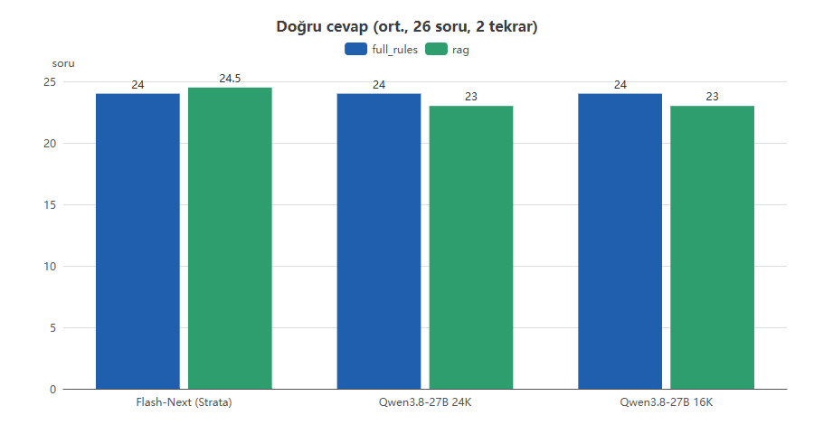
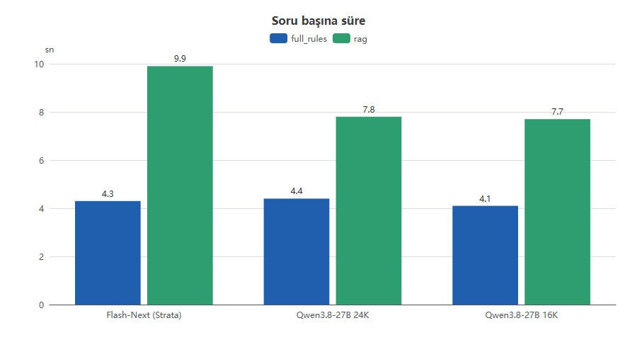
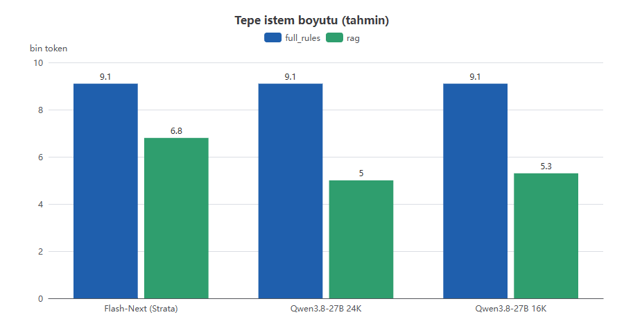
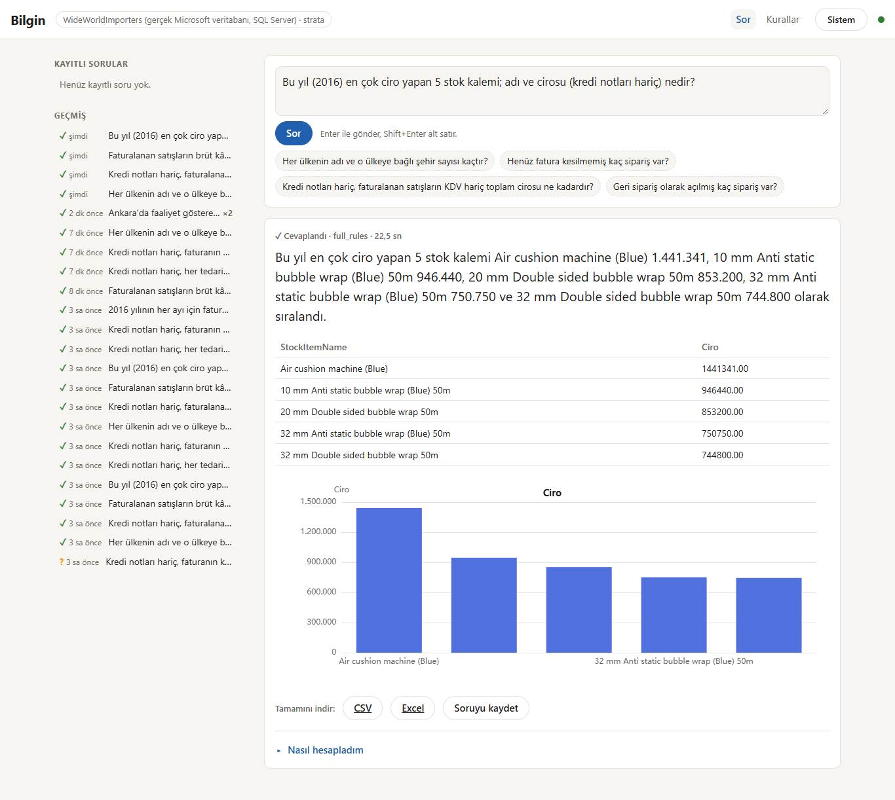

# Bilgin: Teknik Doküman

*ERP verisine Türkçe (ve İngilizce) soru soran, yerel çalışan yapay zekâ veri analisti · sürüm 3 · 28 Ekim 2026 · hazırlayan: Claude (Eren'in projesi için)*

> Sürüm 3'te değişenler: Run 6-8 tamamlandı (kullanıcılar ve roller, Excel şablonuyla yeni veritabanı, ardışık
> soru-cevap, iş rolüne göre başlangıç ekranı, bağlantı yönetimi, İngilizce, Windows servisi). Bölüm 10 artık plan
> değil, ne yapıldığını anlatıyor. Geliştirme modeli Strata 0.2.7'ye geçti ve ölçüm yeniden alındı (6.3). Test sayısı
> 4.215'ten 7.321'e çıktı. Sürüm 2 `BILGIN-TEKNIK-DOKUMAN.md.bak-20261028` dosyasında.

---

## 1. Özet

Bilgin, bir ERP kullanıcısının SQL bilmeden soru sorup kendi veritabanından cevap almasını sağlar. Soruyu T-SQL'e
çevirir, sorguyu **salt-okunur** çalıştırır, sonucu tablo, grafik ve doğal bir cümleyle gösterir. Her şey müşterinin
kendi makinesinde çalışır; ne veri ne soru bir bulut servisine gider.

Bugünkü durum:

- **Doğruluk:** Microsoft'un gerçek **WideWorldImporters** veritabanında (SQL Server, salt-okunur giriş) 26 iş
  sorusunun **24'ünü** doğru cevaplıyor, soru başına **~4 saniyede**. Aynı sonuç 24 GB'lık bir müşteri kutusuna sığan
  **Qwen3.8-27B (16K bağlam)** modelinde de alınıyor. Yanlış iki soru sorunun iki türlü okunabilmesinden geliyor,
  SQL becerisinden değil. WWI'nin SQLite kopyasında `rag` modu 26/26.
- **Ürün:** login ve roller, Excel şablonuyla yeni veritabanı tanıtma, ardışık soru-cevap, iş rolüne göre hazır soru
  kartları, yönetici panelinden şifreli bağlantı yönetimi, Türkçe ve İngilizce arayüz, Windows servisi olarak kurulum.
- **Kalite:** 575 commit, **6.636 Python + 685 arayüz testi**, hepsi yeşil (28 Ekim).

## 2. Problem ve yaklaşım

ERP'deki veri, onu soracak insanın erişemediği yerde durur: rapor bir IT talebine, talep günlere dönüşür. Genel amaçlı
"veriyle sohbet" araçları ise iki yerden tökezler: veriyi buluta taşırlar ve sayıyı modele hesaplatırlar.

Bilgin'in dört ilkesi bu iki sorunun cevabı:

| İlke | Ne demek |
|---|---|
| **Veri evde kalır** | Model, veritabanı ve arayüz müşterinin makinesinde. Bulut LLM API'si yok. |
| **SQL tek doğruluk kaynağı** | Her sayı veritabanında, SQL ile hesaplanır. Model sayı üretmez; cümledeki her sayı kodla doğrulanır. |
| **Model dil katmanıdır** | Model soruyu anlar, SQL'i yazar, sonucu anlatır. Toplam, oran, ortalama gibi hesaplar yapmaz. |
| **Güvenlik veritabanında** | Asıl sınır salt-okunur SQL girişi ve kolon bazlı DENY'dır; uygulama içi kontroller ikinci katmandır. |

## 3. Mimari

```
Soru (Türkçe / İngilizce)  [+ önceki 3 turun sorusu, SQL'i ve maskelenmiş en fazla 5 satırı]
  -> Ajan döngüsü (yerel LLM, araç çağrıları)
       araçlar: şema arama · tablo detayı · örnek değerler · SQL deneme · SQL gönderme · netleştirme sorusu
  -> Politika (sqlglot ağacı: tek SELECT, izin listesi, TOP sınırı, kişisel veri filtresi, kapalı kolon)
  -> Yürütücü (salt-okunur bağlantı, satır ve süre bütçesi) -> kişisel veri maskesi -> denetim kaydı
  -> Rapor: grafik seçimi (kod) + olgular (kod) + anlatım (LLM, sorunun dilinde) + sayı bekçisi (kod)
  -> Web arayüzü / komut satırı / JSON API / Windows servisi
```

**Bağlam stratejisi.** İki mod var. `full_rules` tüm şemayı ve iş kurallarını modele verir; `rag` yalnızca ilgili
tabloları hibrit arama (yoğun vektör + BM25, RRF ile birleşik) ve join grafiğiyle getirir. Küçük şemada `full_rules`
daha hızlı, büyük şemada `rag` bağlamı küçültür. `auto` mod token bütçesine göre seçer.

**İş kuralları katmanı.** "Ciro", "net satış", "geciken teslimat" gibi terimlerin şirkete özgü tanımı ayrı bir kural
dosyasında durur: tanım, SQL ipucu, ilgili tablolar, doğrulama işaretleri ve Türkçe / İngilizce eş anlamlılar
(`synonyms`, `synonyms_en`). İngilizce sorulan bir soru, tarifi Türkçe yazılmış kurala da ulaşır.

**Rapor katmanı.** Sonuç tablosundan grafik türünü ve "en yüksek, toplam, değişim" gibi olguları kod çıkarır. Model
bunları 1-3 cümlelik bir cevaba çevirir. Sayı bekçisi cümledeki her sayının sonuçta ya da olgularda birebir geçtiğini
doğrular; dilin sayı biçimini (`1.234,56` / `1,234.56`, `12.5K`) tanır, öteki dilin biçimini ve teknik kolon adını
reddeder. Geçmeyen cümle bir kez daha istenir, yine geçmezse koddan kurulan kalıp cümle gösterilir. Kullanıcıya
doğrulanmamış bir sayı gitmez.

**Konuşma (Run 7).** Ardışık sorular önceki cevaba dayanabilir ("Bu müşteriye başka ne sattık?"). Model son üç turun
sorusunu, SQL'ini ve maskelenmiş en fazla 5 satırını görür; tam sonuç saklanmaz. Devam cevabının kanıtı nasıl
okunduğunu yazar ("Önceki cevaptan: müşteri 832"). Önceki turun bir sayısı yeni cevaba kopyalanamaz. "Grafiği çubuk
yap" gibi görünüm değişiklikleri modele hiç gitmez.

**Netleştirme.** Soru iki türlü okunabiliyorsa model cevap yerine seçenekli bir "Netleştirelim" kartı açabilir.

**Arayüz.** React + ECharts, tamamen yerel (dış URL yok). Login ekranı, iş rolüne göre başlangıç kartları, soru kutusu,
cevap kartı (cümle, uyarılar, tablo, grafik, CSV/Excel indirme, "nasıl hesapladım" bölümü), konuşma geçmişi, kayıtlı
sorular, iş kuralı ekranı, veritabanı haritası, kullanıcı ve bağlantı yönetimi (yönetici), TR | EN dil düğmesi,
header'da veritabanı durumu göstergesi, telefon düzeni ve karanlık mod.

### 3.1 Teknoloji yığını

**Dil ve çalışma ortamı**

| Katman | Teknoloji | Sürüm | Not |
|---|---|---|---|
| Arka uç dili | Python | 3.11.9 (`requires-python >= 3.11`) | Paket adı `bilgin`, komut satırı `python -m bilgin` |
| Ön uç dili | JavaScript (JSX) | Node.js 24.21 ile derlenir | Çalışma anında Node gerekmez; derlenmiş dosyalar Python sunucusundan servis edilir |
| İşletim sistemi | Windows 11 (geliştirme ve servis), WSL2 Ubuntu 24.04 (model sunumunun bir kısmı) | | Windows servisi: WinSW |

**Arka uç kütüphaneleri** (sürümler `pyproject.toml`'da sabitlenmiş)

| Kütüphane | Sürüm | Ne için |
|---|---|---|
| sqlglot | 30.24.0 | SQL'i ağaç olarak çözümleme: politika (tek SELECT, izin listesi, TOP, kişisel veri filtresi), T-SQL → SQLite çevirisi, kolon izi (maskeleme) |
| FastAPI | 0.162.0 | Web API (soru, konuşma, kurallar, şablon, bağlantılar, kullanıcılar, dışa aktarma, sağlık) |
| Uvicorn | 0.54.0 | API sunucusu (yalnız 127.0.0.1) |
| openai (Python SDK) | 3.37.0 | Yerel modellerin OpenAI uyumlu uç noktalarına istemci (bulut değil: Strata, Unsloth Studio, llama.cpp) |
| pyodbc | 5.3.0 | SQL Server bağlantısı (ODBC Driver 17/18) |
| openpyxl | 3.1.5 | Excel: şema haritası, Türkçe ve İngilizce veritabanı şablonu, Excel dışa aktarma |
| Standart kütüphane | | `sqlite3` uygulama veritabanı; `hashlib.scrypt` parola hash'i; `ctypes` + DPAPI ile bağlantı parolası ve model anahtarı şifreleme |
| pytest / httpx | 9.1.1 / 0.28.1 | Testler ve API testleri (FastAPI TestClient) |

Bilinçli olarak **eklenmeyenler**: ORM, vektör veritabanı, LangChain türü çerçeveler, `python-multipart`, i18n
kütüphanesi (dil kataloğu iki JSON dosyası: `bilgin/i18n/tr.json`, `en.json`; anahtar setlerinin eşitliğini test
kontrol eder).

**Ön uç kütüphaneleri** (`web/package.json`)

| Kütüphane | Sürüm | Ne için |
|---|---|---|
| React / React DOM | 19.3.1 | Arayüz bileşenleri |
| ECharts | 6.1.0 | Grafikler (grafik türünü ve verisini Python tarafı seçer, ECharts yalnız çizer) |
| Vite | 8.3.5 | Derleme; çıktı `bilgin/web/static` |
| Vitest | 5.0.5 | Ön uç birim testleri |

Arayüz dış URL kullanmaz (yazı tipi, CDN, analitik yok); bir test bunu derlenmiş dosyada kontrol eder.

**Modeller** (hepsi yerel)

| Rol | Model | Sunum | Bağlam |
|---|---|---|---|
| Geliştirme / ana model | Qwen3.8-Flash-Next, UD-IQ4_XS | Strata **0.2.7** (engine 0.1.52; OpenAI + Anthropic uyumlu API, `127.0.0.1:8080`) | 256K |
| Müşteri kutusu adayı | Qwen3.8-27B, UD-Q4_K_XL (~17,6 GB) | Unsloth Studio (WSL2, `:8888`) | 16K / 24K denendi |
| Gömme (RAG) | EmbeddingGemma-300M, Q8_0 | llama.cpp `llama-server --embedding` (CPU, `:8891`) | — |

Gömme tarafında ürün hedefi MIT lisanslı bir model (bge-m3); EmbeddingGemma Gemma kullanım koşullarına tabidir.
Testlerde gerçek model hiç çağrılmaz: sahte model (`--llm fake`) altın SQL'i oynatır, sahte gömücü deterministiktir.

**Veritabanları**

| Veritabanı | Kullanım |
|---|---|
| Microsoft SQL Server 2022 Express | Gerçek WideWorldImporters; müşteri ERP'leri bu sınıfta. Bağlantı ODBC Driver 18, `ApplicationIntent=ReadOnly`, salt-okunur giriş |
| SQLite | Sentetik ERP ve WWI kopyası (testler ve demo), uygulamanın kendi verisi (kullanıcılar, oturumlar, kayıtlı sorular, konuşmalar, bağlantılar, başlangıç kartları) |

**Geliştirme ve doğrulama araçları**

| Araç | Ne için |
|---|---|
| Hibrit orkestratör (Python, `local-agent-stack/hybrid`) | Plan → görev → kabul komutu → review döngüsü; test bekçisi, eskiyen test güncellemesi, proje geneli kontroller, run zinciri |
| Claude Code CLI | Görevleri yazan yerel modelin çalıştığı araç ortamı; bulut Claude plan ve review'da |
| Playwright 1.64 + Microsoft Edge (headless) | Görsel kontrol: ekran görüntüleri, kullanıcı akışları, PDF üretimi |
| WinSW v2.12.0 (MIT) | Windows servis sarmalayıcısı; kurulum betiği SHA-256'yı doğrulamadan kurmaz |

## 4. Güvenlik katmanları

| Katman | Ne yapar | Neden |
|---|---|---|
| **Salt-okunur SQL girişi** | Yalnız izin listesindeki tablolarda SELECT; kişisel veri ve kapalı kolonlarda kolon bazlı DENY; yordam çalıştırma ve tanım görme yok; bağlantı `ApplicationIntent=ReadOnly`. | Asıl sınır. Uygulama atlatılsa bile veritabanı reddeder. |
| **Yetki kilidi (Run 7)** | Kaydedilmek istenen bağlantının login'i sysadmin, db_owner ya da yazma yetkili çıkarsa bağlantı reddedilir. | Yanlış login'le "salt-okunur" sözü sessizce bozulmasın. |
| **Politika (sqlglot)** | Tek SELECT, yazma/DDL yok, sistem şemaları yok, TOP sınırı, kişisel veri kolonunda filtre/sıralama yok. | Hatayı sorgu gitmeden yakalar ve modele *neden* yanlış olduğunu söyler. |
| **Kişisel veri maskesi** | Kimlik no, IBAN, telefon, ad soyad, maaş vb. sınıfına göre maskelenir; tek kişilik gruplarda toplam da maskelenir. Konuşma geçmişine de yalnız maskelenmiş satırlar girer. | Sayısal özet serbest, kişiye ulaşan değer kapalı. |
| **Login ve roller (Run 6)** | scrypt hash, HttpOnly + SameSite=Strict oturum çerezi, 5 hatalı denemede 15 dakika kilit, aynı hata mesajı; `user` / `admin` kontrolü sunucuda, her API yolu tablo halindeki bir testle üç durumda denenir. | Uygulamanın hiçbir parçası oturumsuz görünmez. |
| **Sırlar** | Bağlantı parolası ve model anahtarı DPAPI ile şifreli; hiçbir API geri döndürmez, loglara girmez. Servis tanımı (XML) adında `PASSWORD`, `KEY`, `SECRET`, `CONN`, `TOKEN` geçen hiçbir ortam anahtarını kabul etmez; sır klasörünü yalnız Yöneticiler ve `NT SERVICE\Bilgin` okur. | Bağlantı dizesi her yöneticinin okuyabildiği bir dosyaya düşmez. |
| **Denetim kaydı** | Her sorgu, kaynağı ve maskelenen kolonların *adı* yazılır, değeri yazılmaz. | İz sürülebilirlik. |

Bağlantı dizesi kodda, yapılandırmada ve repoda yoktur. 28 Ekim'de Cloudflare'in açık kaynak `security-audit`
yöntemiyle kod üzerinde ayrı bir güvenlik denetimi başlatıldı; sonucu bu dokümanın bir sonraki sürümüne girecek.

## 5. Ölçüm yöntemi

Her veri kümesi bir **altın soru seti** taşır: soru, doğru SQL, etiketler (tuzak, kural gerektiren, çok tablolu, değer
gerektiren). Değerlendirme modelin sonucunu altın SQL'in sonucuyla karşılaştırır; SQL metni değil, **dönen satırlar**
eşleşmeli. Tuzak soruları kasıtlıdır: faturalanmamış sipariş, kredi notu düşümü, geri sipariş, teslimi onaylanmamış
fatura, iki satın alma grubu, geç teslimat.

`eval --compare` modelleri ve modları aynı setle koşar, `--repeat N` her hücreyi N kez tekrarlayıp gürültüyü
(min-max) gösterir. Run 7-8 ile üç ölçüm daha geldi: `--followups` (2-3 soruluk konuşma zincirleri), `--lang en`
(İngilizce altın set `E01-E26`, SQL'i Türkçe setin kopyası) ve `--narrate` (anlatımın kaynağı). Grafikler ve tablolar
bu raporlardan **kodla** üretilir.

## 6. Sonuçlar

### 6.1 Gerçek WideWorldImporters (SQL Server, 26 soru, 2 tekrar, 25 Ekim)

| Model | Mod | Doğru (ort.) | min-max | Cevap % | sn/soru | Tepe istem | Taşma |
| --- | --- | ---: | ---: | ---: | ---: | ---: | ---: |
| Flash-Next (Strata) | full_rules | 24.0/26 | 24-24 | 100 | 4.3 | 9,088 | 0 |
| Flash-Next (Strata) | rag | 24.5/26 | 24-25 | 100 | 9.9 | 6,760 | 0 |
| Qwen3.8-27B 24K | full_rules | 24.0/26 | 24-24 | 100 | 4.4 | 9,084 | 0 |
| Qwen3.8-27B 24K | rag | 23.0/26 | 23-23 | 100 | 7.8 | 5,024 | 0 |
| Qwen3.8-27B 16K | full_rules | 24.0/26 | 24-24 | 100 | 4.1 | 9,086 | 0 |
| Qwen3.8-27B 16K | rag | 23.0/26 | 23-23 | 100 | 7.7 | 5,309 | 0 |







**Okuma:**
- `full_rules` modunda üç model aynı: 24/26, 4,1-4,4 sn. 27B'yi 16K yerine 24K bağlamla çalıştırmak bir şey katmıyor.
- `rag` modunda 27B bir soru geride: müşteri bakiyesi sorusunu (Q10) her tekrarda yanlış yaptı.
- Yedi tuzak sorusunun yedisi de doğru.
- Yanlış iki soru (Q01, Q25) bütün modellerde aynı ve ikisi de **soru belirsizliği**:
  - Q01: "her ülkenin şehir sayısı" şehri olmayan 189 ülkeyi de kapsıyor gibi okunuyor; modeller 0'lı satırları da
    döndürüyor, altın cevap yalnız ABD'yi istiyor.
  - Q25: "faturanın kesildiği müşteri" fatura müşterisi mi sipariş müşterisi mi, belli değil. Soru fatura müşterisi
    açıkça yazılarak sorulduğunda model altın cevapla aynı sonucu veriyor.

**Donanım önerisi.** 24 GB VRAM'li bir müşteri kutusu için: **Qwen3.8-27B, 4-bit, 16K bağlam, `full_rules`**.
Bu boyuttaki bir şemada geliştirme modeliyle aynı doğruluk ve hız. Şema pencereye sığmayacak kadar büyürse `rag`'a
geçilir; bedeli soru başına ~3,5 saniye ve bu sette bir soruluk doğruluk. (Modelin ve gömme modelinin lisansı ticari
kullanımdan önce ayrıca doğrulanmalı; gömme tarafında ürün hedefi MIT lisanslı bir model.)

### 6.2 Sentetik ERP (83 tablo, 40 soru, 15 iş kuralı)

Türk ERP'lerine benzeyen kodlu tablo adlarıyla kurgusal bir veritabanı; çoğu tablo modeli şaşırtmak için konmuş boş
tablolardır. Geliştirme modeliyle tek koşum:

| Mod | Doğru | Tepe istem |
|---|---:|---:|
| full (şema, kural yok) | 23/40 | 23,6K |
| full_rules | **31/40** | 26,0K |
| rag | **30/40** | **6,5K** |

En büyük kazanç modelden değil **iş kuralları katmanından** geldi: aynı model, kurallarla 8 soru daha fazla doğru
yaptı. `rag` aynı doğruluğa dört kat daha küçük bağlamla yaklaşıyor.

### 6.3 Run 8 sonrası yeniden ölçüm (WWI SQLite kopyası, Strata 0.2.7, 28 Ekim)

Run 6-8 koda dil kataloğu, konuşma ve yeni sayı biçimleri ekledi; geliştirme modeli de Strata 0.1.43'ten 0.2.7'ye
geçti. İkisinin doğruluğu bozmadığını görmek için aynı 26 soru tek koşumla yeniden ölçüldü:

| Mod | Doğru | Tepe bağlam | Süre (26 soru) |
|---|---:|---:|---:|
| full | 24/26 | 6,8K | 143 sn |
| full_rules | 24/26 | 8,5K | 91 sn |
| rag | **26/26** | 5,4K | 227 sn |

24 Ekim'deki ölçümle (full_rules 24/26, rag 26/26) aynı. Strata 0.2.7 aynı makinede kısa kod yazarken %8, 16K'lık
istemi okurken %10 daha hızlı; 64K'lık istemde fark yok.

## 7. Arayüzden örnekler (gerçek veritabanı)

Cümleler arayüzün döndürdüğü haliyle, değiştirilmeden:

| Soru | Model | Cevap | Süre |
|---|---|---|---|
| Kredi notları hariç, faturalanan satışların KDV hariç toplam cirosu ne kadardır? | 27B 16K | Kredi notları hariç faturalanan satışların KDV hariç toplam cirosu 172.261.341,2'dir. | 9,8 sn |
| Bu yıl (2016) en çok ciro yapan 5 stok kalemi; adı ve cirosu nedir? | Flash-Next | Bu yıl en çok ciro yapan 5 stok kalemi Air cushion machine (Blue) 1.441.341, 10 mm Anti static bubble wrap (Blue) 50m 946.440, 20 mm Double sided bubble wrap 50m 853.200, 32 mm Anti static bubble wrap (Blue) 50m 750.750 ve 32 mm Double sided bubble wrap 50m 744.800 olarak sıralandı. | 24,4 sn |
| Kredi notları hariç, her tedarikçinin ürünlerinden elde edilen toplam ciro tedarikçi adına göre nedir? | 27B 24K | Kredi notları hariç tutulduğunda tedarikçi başına toplam ciro şöyle görünüyor: Litware, Inc. 100.664.171,55; Fabrikam, Inc. 46.441.244; Northwind Electric Cars 14.802.215; The Phone Company 5.763.945,45; Graphic Design Institute 3.172.130; A Datum Corporation 1.142.515,2 ve Contoso, Ltd. 275.120. | 18,4 sn |



Bu ekran görüntüleri Run 5 arayüzünden; login, başlangıç kartları ve dil düğmesiyle yenilenmiş ekranlar henüz
çekilmedi (bkz. 11).

## 8. Gerçek veritabanının öğrettikleri

Sentetik veride görünmeyen, gerçek SQL Server'a ilk bağlantıda çıkan bulgular. Her biri düzeltildi ya da kayıt
altında:

1. **Modelin hafızasından yazılan şema güvenilmez.** İlk WWI şeması belgelerden ve modelin bilgisinden yazılmıştı:
   175 kolonun 44'ü gerçek veritabanında yoktu. Gerçek şema, veritabanının kendi meta verisinden ve Microsoft'un
   kolon açıklamalarından yeniden kuruldu. Ders: müşteri veritabanında şema **her zaman canlı veritabanından okunur**.
2. **Bir kolon adı iş tanımını taşımayabilir.** Gerçek veride fatura satırının `ExtendedPrice`'ı KDV **dahil**.
   KDV hariç ciro `ExtendedPrice - TaxAmount`. Kural katmanı tam bunun için var; model bu tuzağı doğru geçti.
3. **Kolon bazlı DENY `COUNT(*)`'ı kırar.** Kişisel veri kolonları kapatılmış bir tabloda SQL Server `COUNT(*)`'ı
   reddediyor. Politika katmanı artık bu tablolarda `COUNT(*)`'ı anahtar kolonla sayıma çeviriyor; aynı satırları sayar.
4. **Satır düzeyi güvenlik sessizce sıfır döndürür.** Örnek veritabanındaki bir satış bölgesi kuralı salt-okunur
   girişe 0 müşteri gösteriyordu. Hata vermediği için fark etmesi zor; kurulum adımlarına eklendi.
5. **Gerçek tutarlar ondalık tipte gelir.** JSON çıktısı `Decimal` tipinde çöküyordu; düzeltildi.
6. **Cevap cümlesi teknik dil konuşmamalı.** İlk cevaplarda kolon adları geçiyordu ("StateProvinceName olarak
   Texas…"). Anlatım kuralları değişti ve kod bu adları cümleden reddediyor.

## 9. Geliştirme yöntemi

Proje "bulut beyin, yerel eller" düzeniyle yazıldı. Bulut model (Claude Opus / Sonnet) planı ve görev listesini
yazar, kilometre taşı sonlarında kodu gözden geçirir. Görevleri yerel model (Qwen3.8-Flash-Next, Strata) yazar ve
test eder. Deterministik bir orkestratör döngüyü yönetir: kabul komutu, var olan testlerin zayıflatılmasını
engelleyen bekçi, bilerek değiştirilen davranışı sabitleyen eski testlerin denetimli güncellenmesi, proje geneli test
ve smoke kontrolleri, ekran görüntüsüyle görsel inceleme.

| Run | Kapsam | Görev (ilk denemede) |
|---|---|---|
| 1 | Test veritabanı, politika, yürütücü, ajan, ölçüm, komut satırı | 30 (30) |
| 2 | 83 tablo, iş kuralları, 40 soru, hibrit arama, join grafiği, A/B ölçüm | 76 |
| 3 | Excel eşleme, canlı şema okuma ve fark raporu, kişisel veri maskesi, salt-okunur giriş betiği, `auto` mod | 44 (38) |
| 4 | Veri kümesi yapısı, WWI, model profilleri, bağlam bütçesi, model karşılaştırma | 39 (37) |
| 5 | Soru-cevap oturumu, rapor katmanı, netleştirme, tablo özetleri, web arayüzü, kural ekranı | 26 (26) |
| 6 | Kullanıcılar ve roller, login, Excel şablonuyla yeni veritabanı | 61 (59) |
| 7 | Konuşma, başlangıç ekranı, bağlantı yönetimi | 36 (31) |
| 8 | İngilizce, Windows servisi | 105 (96) |

Run 8'den açık kalan tek görev (T455, Windows servisinin uçtan uca testi) 28 Ekim'de MERGEN'e verildi; testi yerel
model yazdı, tam test seti ve commit elle doğrulandı. Toplam: **575 commit, 6.636 Python ve 685 arayüz testi**.

Bütün bu geliştirmede bulut modele giden token'ların payı %6 civarında; kodun %90'ından fazlası ilk denemede kabul
testini geçti. Ayrıntılı sayılar ve "aynı işi bulut model yapsaydı" maliyet karşılaştırması MERGEN'in
`docs/hybrid-results.md` dokümanında.

## 10. Run 6-8'de gelenler

### 10.1 Run 6 - Kullanıcılar, roller ve yeni veritabanı şablonu

- **Giriş ve oturum:** kullanıcılar uygulamanın kendi SQLite dosyasında; parolalar standart kütüphanenin scrypt'iyle
  hash'lenir. İlk yönetici komut satırından, parola gizli yazılarak açılır; geliştirme için bir ortam değişkeniyle
  geliştirme yöneticisi kendiliğinden açılabilir (parola kodda ve repoda yok; Windows servisinde bu yol kapalıdır).
- **Her adres login'e gider:** oturum yoksa uygulamanın hiçbir parçası görünmez; giriş sonrası istenen sayfaya dönülür.
- **Roller:** `user` soru sorar, kendi geçmişini görür, kaydeder, dışa aktarır, iş kurallarını salt-okunur görür.
  `admin` ayrıca iş kurallarını, kullanıcıları ve bağlantıları yönetir, yeni veritabanı tanıtır.
- **Yeni veritabanını Excel şablonuyla tanıtmak:** admin boş şablonu ya da bağlantı varsa yapısı veritabanından
  doldurulmuş şablonu indirir, doldurup yükler; önce hiçbir şey yazmadan bir kontrol raporu gelir; "Oluştur" ile yeni
  veri kümesi, salt-okunur login betiği ve RAG indeksi kurulur. Var olan veri kümelerine hiçbir yükleme dokunmaz.

### 10.2 Run 7 - Konuşma, başlangıç ekranı ve bağlantı yönetimi

- **Ardışık soru-cevap** ve rapor düzenleme ("Sadece Texas", "Geçen yılla karşılaştır", "Grafiği çubuk yap"); kurallar
  3. bölümde.
- **İş rolüne göre başlangıç ekranı:** iş rolü (Satış, Satın alma, Muhasebe, Yönetim, Genel) yetki rolünden ayrıdır.
  Kartlar modele gitmez, admin'in onayladığı sabit SQL'i salt-okunur çalıştırır, sonuç 5 dakika önbellekte durur.
  Karta tıklayınca konuşma oradan devam eder. Yeni bir veritabanında Bilgin her rol için soru önerir; onaylanmayan
  öneri çalışmaz. BI panosu değildir: her kart Bilgin'in cevaplayıp sürdürebileceği bir sorudur.
- **Bağlantılar yönetici panelinden:** her veri kümesinin kendi bağlantısı; parola DPAPI ile şifreli; yetki kilidi
  (4. bölüm). Header'da yeşil / kırmızı / gri veritabanı göstergesi; bağlantı yokken soru modeli beklemeden hemen
  "şu an cevap üretilemiyor" der.

### 10.3 Run 8 - İngilizce ve Windows servisi

- **Programın İngilizcesi:** arayüz, API mesajları, cevap cümlesi, netleştirme, uyarılar, grafik etiketleri, komut
  satırı ve README (`README.md` İngilizce, `README.tr.md` Türkçe). Dil sırası: kullanıcının tercihi →
  `Accept-Language` → `BILGIN_LANG`. **Cevabın dili sorunun dilidir**, ekran dilinden ayrıdır. Veri çevrilmez.
- **Şablon programın dilinde:** İngilizce kullanıcıya İngilizce şablon; iki şablon da hangi dilde olursa olsun okunur
  ve aynı şemayı üretir.
- **Windows servisi:** yükseltilmiş bir kabuktan tek betikle kurulum (`scripts\install-service.ps1`), Windows'la
  birlikte açılır, çökerse yeniden başlar, sanal hesapla (`NT SERVICE\Bilgin`) çalışır, verisi
  `C:\ProgramData\Bilgin` altında, logları boyuta göre döner, yalnız `127.0.0.1:8777`'den erişilir. Güncelleme ve
  kaldırma betikleri; her adımı değiştirmeden gösteren `-WhatIf`. `python -m bilgin paths` veri yerlerini sırları
  göstermeden yazar.

## 11. Açık işler

1. **Güvenlik denetiminin sonucu** (28 Ekim'de başladı, yerel modelle): bulgular okunacak, doğrulanan her bulgu bir
   düzeltme görevine dönecek.
2. **Gerçek modelle İngilizce ve konuşma ölçümü.** `eval --lang en` ve `eval --followups` şimdiye kadar yalnız sahte
   modelle (kablo testi) koştu; gerçek WWI'de Flash-Next ve 27B ile ölçülecek.
3. **Windows servisinin elle kontrol listesi.** `$WinSwSha256` resmî WinSW sürüm sayfasından doldurulacak; kurulum,
   yeniden başlatma sonrası açılış ve kaldırma elle denenecek.
4. **Q01 ve Q25'i netleştirmek.** Soru metni tek okumaya indirilecek; gerçek veride hedef 26/26.
5. **Kendi ERP verisinde deneme.** Demo verisiyle dolu bir ERP veritabanı, Run 6 şablonuyla tanıtma, salt-okunur
   giriş, iş kuralları ve 20-30 gerçek kullanıcı sorusundan bir altın set.
6. **Yeni arayüzün ekran görüntüleri** (login, başlangıç kartları, İngilizce cevap) bu dokümana.
7. **Ölçüm tekrarı.** 27B için daha fazla tekrar ve 16 GB VRAM'e sığan daha düşük bit seçeneğinin ölçümü.
8. **Lisans kontrolü.** Ticari dağıtımdan önce model ve gömme modelinin lisansları; gömme için MIT lisanslı modele geçiş.
9. **Ağa açma.** Bilgin şimdilik yalnız yerel makineden erişiliyor; birden çok bilgisayardan kullanım TLS ve ağ
   güvenliği ayrıca ele alınınca.
