# Bilgin: Proje Dokümanı

*BusAIness ürünü · çalışma adı NL2SQL · sürüm 0.5 · 25 Ekim 2026 · hazırlayan: Eren · yazım: MERGEN*

---

## 1. Özet

Bilgin, ERP kullanıcılarının SQL bilmeden, Türkçe soru sorarak kendi veritabanlarından rapor almasını sağlayan,
**müşterinin kendi sunucusunda çalışan** bir yapay zekâ veri analistidir. Soruyu SQL'e çevirir, sorguyu salt-okunur
çalıştırır ve sonucu gösterir. Veri şirketin dışına hiç çıkmaz.

> *"Bilgin sende kalır."*

## 2. Problem

- KOBİ ve orta ölçekli şirketlerde rapor ihtiyacı bir kuyruğa dönüşür. Basit bir soru ("Eylül'de en çok satan
  5 ürün?") için bile IT'ye ya da ERP danışmanına iş açılır ve cevap günler sürer.
- Bulut tabanlı BI/AI araçları (Power BI Copilot, Tableau vb.) önce bir veri modeli ister ve veriyi buluta taşır.
  KVKK'ya hassas şirketler için bu bir engeldir.
- ERP şemaları şifrelidir (`STHAR_GCKOD`, `TBLFATUIRS`). Genel amaçlı bir LLM bunları ve şirketin iş kurallarını
  ("net satış iadeyi düşer mi?") bilmez.

## 3. Amaç

ERP verisine **Türkçe soru → doğru sayı** yolunu, verinin şirketten çıkmadığı ve sistemin veriyi hiçbir koşulda
değiştiremediği bir şekilde dakikalara indirmek.

## 4. Hedefler

| # | Hedef | Ölçüt | Durum |
|---|---|---|---|
| H1 | Yerel bir model doğru SQL yazabiliyor mu? (Faz 0 eleme kapısı) | 10 altın soruda ≥ 7/10 execution accuracy | ✅ 7/10 (Run 1) |
| H2 | Büyük, kafa karıştırıcı bir şemada doğruluk | 83 tablo, 40 soru; şema + iş kurallarıyla ≥ %75 | ✅ 31/40 = %78 (Run 2) |
| H3 | Küçük donanımda çalışabilme | 16-24K context bütçesine sığmak | ✅ RAG modu: 6,5K token (tam şema 26K) |
| H4 | Müşteri şemasını elle yazmadan almak | Excel haritası ve/veya canlı DB'den otomatik şema; fark raporu | 🔄 Run 3 |
| H5 | Kişisel veriyi korumak | PII maskeleme; ≥ 20 atlatma denemesinin tamamı engelleniyor | 🔄 Run 3 |
| H6 | Kullanıcıya rapor | Web arayüzü; yazılı Türkçe yorum (number guard'lı); grafik | ⏳ Run 4 |
| H7 | Gerçek veride doğruluk | ERP/Odoo kopyasında Eren'in 20-30 sorusu | ⏳ Run 3 sonrası |

## 5. Kapsam

**İçinde:** Doğal dilden T-SQL'e çeviri, agent döngüsü (şema arama, join yolu, örnek değer, çalıştır, düzelt), iş
kuralları, salt-okunur çalıştırma, güvenlik politikası, PII maskeleme, şema haritası içe aktarma (Excel + canlı DB),
ölçüm (eval) altyapısı, CLI; sonraki aşamada web arayüzü, grafik ve yazılı rapor.

**Dışında (şimdilik):** Veritabanına yazma (INSERT/UPDATE), dashboard/BI modelleme, model fine-tune, bulut LLM,
çok turlu sohbet hafızası, mobil.

## 6. Yöntem

### 6.1 Tasarım ilkeleri

1. **Deterministik çekirdek, LLM dil katmanı.** LLM sadece SQL yazar ya da eşleme önerir. Sayıları veritabanı
   hesaplar, dönüşümleri kod yapar. LLM hiçbir kritik sayının sahibi değildir.
2. **Veri evde kalır.** Model (llama.cpp / Strata), embedding (CPU'da llama-server) ve veritabanı aynı ağda çalışır.
   Bulut API'si yoktur.
3. **Sadece okuma.** Read-only login ve `ApplicationIntent=ReadOnly`. Asıl güvence DB seviyesindeki `DENY`'dir,
   sqlglot politikası ikinci katmandır.
4. **ERP'den bağımsız.** ERP'ye özgü bilgi koda gömülmez. Şema haritası, iş kuralları ve ERP profili
   (`datasets/<veri kütesi>/profile.json`) veri olarak yüklenir.
5. **Ölçmeden özellik yok.** Her değişiklik altın soru setinde ölçülür. RAG bile ancak sayıyla kazandığında kalır.

### 6.2 Mimari

```
Excel haritası ──(LLM eşleme önerir, kullanıcı onaylar, kod dönüştürür)──┐
Canlı DB ──introspect──────────────────────────────────────────────────┴─► schema.json + rules.json
                                                                                │ build-index
Soru ─► Agent döngüsü ─► LLM (yerel, OpenAI uyumlu)                       hibrit indeks + join grafiği
          │  araçlar: search_schema · search_rules · get_table_details ·
          │           find_join_path · sample_values · run_sql · submit_sql
          ▼
      Executor: politika (tek SELECT, izin listesi, TOP, PII filtreleri) → çalıştır → PII maskeleme → sonuç
```

- **Modlar:** `full_rules` (şema + kurallar prompt'ta; hızlı) ve `rag` (arama araçlarıyla; 4 kat az context).
  `auto` modu context bütçesine göre birini seçer.
- **Arama:** dense (embedding) + BM25 + RRF birleştirmesi, Türkçe harf katlama. Join yolları vektör aramayla değil,
  FK'ler ve ERP profilinden kurulan grafikte en kısa yolla bulunur.
- **İş kuralları:** "ciro", "net satış", "iade oranı" gibi terimlerin tanımı, eşanlamlıları ve SQL ipucu. Ölçümle
  ürünün en değerli katmanı olduğu görüldü.

### 6.3 Güvenlik katmanları

| Katman | Ne yapar |
|---|---|
| DB login | `db_datareader` + hassas tablo ve kolonlara `DENY` (üretilen script) |
| Politika (sqlglot, parse tree) | Tek SELECT; default-deny tablo listesi; `sys.*`, cross-db, `OPENROWSET`, `SELECT INTO`, TVF yasak; `TOP` zorunlu |
| PII | Lineage ile kaynak kolon takibi; TCKN, IBAN, maaş vb. maskelenir; çözülemeyen kolon tamamen maskelenir; PII ile filtreleme yasak |
| Denetim | Kim, hangi SQL, süre, satır sayısı. Sonuç satırları log'a yazılmaz |
| Test | 50+ kötü niyetli SQL ve 20+ PII atlatma vakası her değişiklikte koşar |

### 6.4 Ölçüm (eval) yöntemi

- **Sentetik ERP benzeri test DB'si:** 83 tablo (21'i veri içeriyor, 62'si şaşırtmaca). Veriye bilerek tuzaklar
  konmuştur: iade, iptal fatura, çok depo, fan-out yapan join, NULL'lar, arşiv tablosu.
- **40 altın soru**, her biri iki yoldan doğrulanır: altın SQL'in sonucu bağımsız bir Python hesabıyla birebir
  tutmalıdır.
- **Execution accuracy:** sonuç kümeleri sıradan ve kolon adlarından bağımsız karşılaştırılır.
- **Ayrıca:** etiket bazında skor, retrieval recall@k (LLM'siz), context ve süre, tekrarlı koşu ile gürültü ölçümü.

### 6.5 Geliştirme yöntemi

Kod, MERGEN'in hibrit hattıyla yazılıyor. Claude (bulut) plan ve review yapıyor, yerel Qwen (Strata) kodluyor,
deterministik bir orkestratör görevleri, testleri ve bütçeyi yönetiyor. Her görevin kabul testi var, her milestone
sonunda tüm proje kontrol ediliyor. Run 3'te bulut limiti dolunca beyin rolünü de yerel model üstlendi; o run'da
33 görev ilk denemede geçti ve review'lar 6 gerçek hata buldu.

## 7. Mevcut durum (25 Ekim 2026)

Run 3, 4 ve 5 bitti: `TASKS.md`deki 222 görevin tamamı kapandı (son görev 25 Ekim 03:45'te işlendi).

| Run | Kapsam | Sonuç |
|---|---|---|
| 1 | Faz 0: test DB, politika, executor, agent, eval, CLI | 30/30 görev; Strata 7/10; hataların hepsi iş tanımı belirsizliğinden |
| 2 | Faz 2: 83 tablo, iş kuralları, 40 soru, hibrit arama, join grafiği, A/B eval | `full` 23/40 · `full_rules` **31/40** · `rag` **30/40** (6,5K token); 2144 test |
| 3 | Excel eşleme, canlı şemayı okuma + fark raporu, kişisel veri maskeleme, salt-okunur login scripti, retrieval iyileştirmeleri, `auto` mod | bitti |
| 4 | WideWorldImporters (public) veri kümesi, model profilleri, bağlam bütçesi (önce kırp, sonra durdur), model × mod karşılaştırma eval'i | bitti (sentetik WWI kopyası üzerindeydi; yerini gerçek DB ölçümü aldı → 7.1) |
| 5 | Soru-cevap oturumu, rapor (grafik + olgular + sayı koruması + Türkçe anlatım), netleştirme soruları, tablo özetleri, web arayüzü ve kural ekranı, telefon düzeni ve karanlık mod | bitti → 7.2 |
| Run sonrası | Gerçek veritabanı: WWI restore, salt-okunur login, `wwi_real` veri kümesi, `COUNT(*)` ve `Decimal` düzeltmeleri | bitti → 7.1, `docs/GERCEK-WWI-TEST.md` |

**Bulgular:**
- İş kuralları tek başına +8 soru kazandırdı (23 → 31). Ürünün hendeği bu katman.
- RAG skorda `full_rules` ile berabere, ama context'i 4 kat azaltıyor. Küçük donanım ve büyük şema için zorunlu.
- Retrieval henüz zayıf: recall@5 = 0,67, en çok çok tablolu join'lerde kaybediyor. Run 5'te tablo özetleri aramaya
  katıldı; `FakeEmbedder` ile ölçülen hybrid recall@5 sentetik sette 0,55 → 0,63, WWI'de 0,72 → 0,85
  (`eval/SUMMARIES.md`, `config.TABLE_SUMMARIES = True`).

*İlk üç madde Run 2 ölçümleridir; model karşılaştırması ve arayüz örnekleri aşağıdaki iki alt bölümde, gerçek veritabanı ölçümüyle.*

### 7.1 Model karşılaştırması (gerçek WideWorldImporters, SQL Server)

Microsoft'un **gerçek** WideWorldImporters yedeği (SQL Server Express, salt-okunur `nl2sql_ro` girişi) üzerinde
26 soru, 2 tekrar; üç model × iki mod. Kaynak: `docs/img/real-compare/results.md` (ham hücreler `results.json`,
grafikler aynı klasörde); ayrıntılı rapor: `docs/GERCEK-WWI-TEST.md`. Tablo olduğu gibi aktarılmıştır; sayılar
yeniden yazılmamıştır. Dünkü ölçüm kodla üretilmiş sentetik bir WWI kopyası üzerindeydi (kolonlarının dörtte biri
yanlıştı); yerini bu ölçüm aldı, eski bölüm geçersizdir.

| Model | Mod | Doğru (ort.) | min-max | Cevap % | sn/soru | Tepe istem | Taşma |
| --- | --- | ---: | ---: | ---: | ---: | ---: | ---: |
| Flash-Next (Strata) | full_rules | 24.0/26 | 24-24 | 100 | 4.3 | 9,088 | 0 |
| Flash-Next (Strata) | rag | 24.5/26 | 24-25 | 100 | 9.9 | 6,760 | 0 |
| Qwen3.8-27B 24K | full_rules | 24.0/26 | 24-24 | 100 | 4.4 | 9,084 | 0 |
| Qwen3.8-27B 24K | rag | 23.0/26 | 23-23 | 100 | 7.8 | 5,024 | 0 |
| Qwen3.8-27B 16K | full_rules | 24.0/26 | 24-24 | 100 | 4.1 | 9,086 | 0 |
| Qwen3.8-27B 16K | rag | 23.0/26 | 23-23 | 100 | 7.7 | 5,309 | 0 |

**Doğruluk**

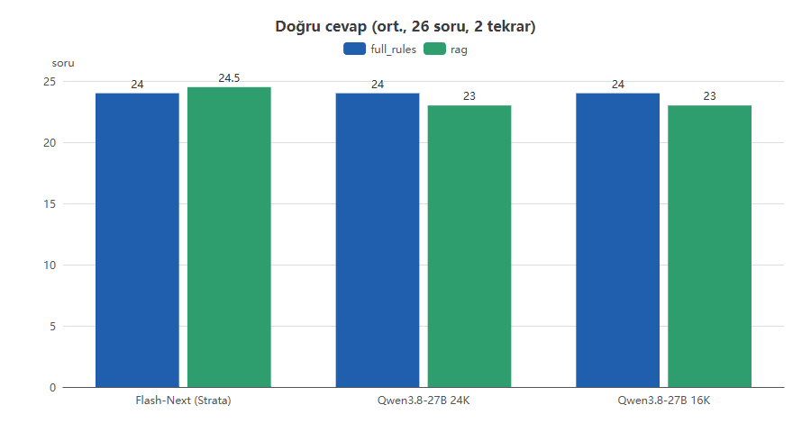

Üç modelin `full_rules` hücreleri puan da bant da aynı: 24.0/26, 24-24 — gerçek veride model farkı yok denecek
kadar küçük. Tek anlamlı fark `rag` tarafında: Flash-Next 24.5/26 (bant 24-25), iki 27B hücresi 23.0/26 (bant
23-23); bantlar değmiyor. Düşen sorular `results.json`'da: Q01 ve Q25 altı hücrenin hepsinde yanlış (Flash-Next
`rag`'da Q25 bir tekrarda geçiyor); 27B `rag`'ın iki hücresi ayrıca Q10'u iki tekrarda da kaçırıyor — 23.0'ın
kaynağı bu. Q01 ve Q25 birer soru-belirsizliği: Q01'de modellerin sayısı doğru (37.940) ama 0'lık 189 ülke
satırını da döndürüyorlar, altın cevap tek satır; Q25'te iki meşru müşteri yolu var ve modeller altın yol dışını
seçiyor (ayrıntı `GERCEK-WWI-TEST.md` §4).

**Hız**

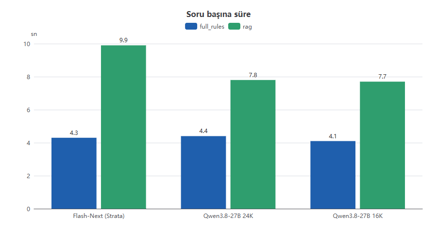

Mod farkı model farkından büyük: `full_rules` 4.1-4.4 sn/soru, `rag` 7.7-9.9 sn/soru. En hızlı hücre Qwen3.8-27B
16K `full_rules` (4.1), en yavaş Flash-Next `rag` (9.9).

**Bağlam**

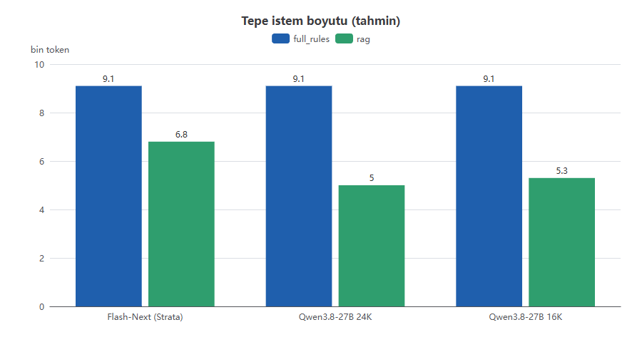

`full_rules` tepe istemi üç modelde de ~9,08K (9,084-9,088); `rag` bunu 5,024-6,760'a indiriyor. Altı hücrenin
hiçbirinde taşma yok: gerçek şema (20 tablo) + kurallar 16K pencereye de sığıyor; 24K pencerenin gerçek bir
ihtiyacı olmadığı ölçüldü.

**24 GB'lık müşteri kutusu için öneri (gerçek veriye göre)**

Gerçek WWI boyutundaki şemada üç model de `full_rules`'da aynı skoru (24.0/26) ~4 sn/soru ve ~9,1K tepe istemle
veriyor; pencere farkı olmadığı için **27B + 16K + `full_rules`** savunulabilir varsayılan. Skor avantajı tek
hücrede: Flash-Next `rag` 24.5/26, bedeli 9.9 sn/soru. 27B için "rag'a düşersem doğruluk korunur" varsayımı gerçek
veride yanlış (24.0 → 23.0). Şema büyüyüp 9,1K'lık tablo baskısı artarsa rag geçişi kaçınılmaz olur — o geçişten
önce 27B `rag`'ın Q10/Q25 kayıpları kapatılmalı. Kesin karar Eren'in demo veritabanı testiyle verilir (ERP
şeması WWI'ın birkaç katı; orada `full_rules` sığmayabilir).

### 7.2 Arayüzden örnekler (gerçek veritabanı)

25 Ekim öğleden sonra anlatım düzeltildi: cümlelerde teknik kolon adı yok (cc93633).

Web arayüzünde (`serve`, `full_rules` modu) üçer modelle gerçek WideWorldImporters'a sorulmuş 6 soru; ekran
görüntüleri düzeltme sonrası yeniden alındı. Cümleler `docs/img/real-shots/*.json` içindeki `answer_text`
alanından birebir, süreler `seconds` alanından. 18 koşunun 18'i de `answer-card` ile bitti.

#### Q01 · Her ülkenin adı ve o ülkeye bağlı şehir sayısı kaçtır?

| Model | Modelin döndürdüğü cümle | Süre | Ekran görüntüsü |
|---|---|---|---|
| Flash-Next | 190 ülke için şehir sayısı listelenmiş; en düşük şehir sayısı 0 olarak görünüyor. Toplam şehir sayısı 37.940, en yüksek şehir sayısı ise United States için 37.940. | 17.4 sn | 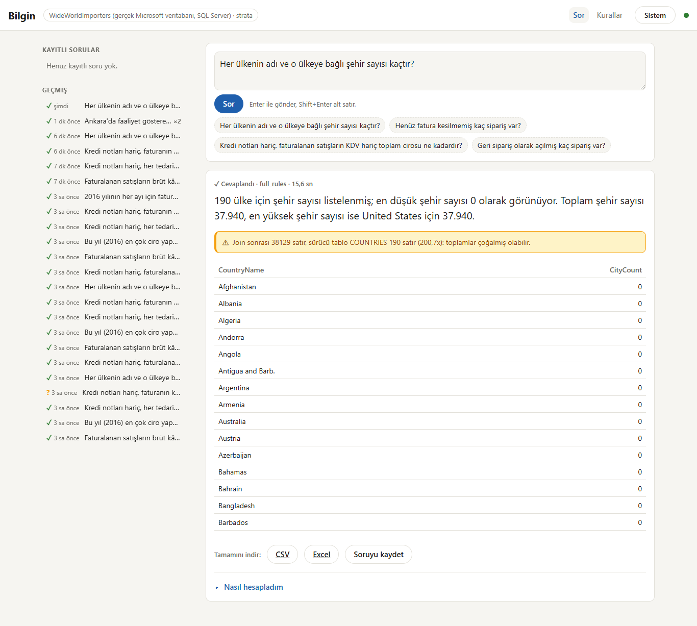 |
| Qwen3.8-27B 24K | Toplamda 190 ülke sonucu bulunuyor; United States için şehir sayısı 37.940, diğer ülkeler için 0. | 29.0 sn | 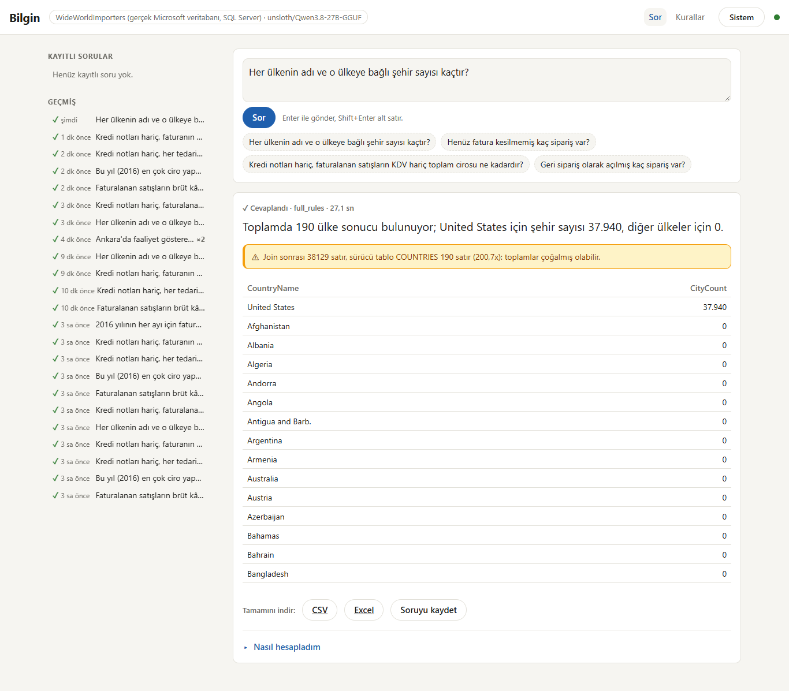 |
| Qwen3.8-27B 16K | Listede 190 ülke yer alıyor; ilk satırlardaki ülkelerin şehir sayısı 0'dır ve en yüksek şehir sayısı United States için 37.940'dur. | 25.9 sn | 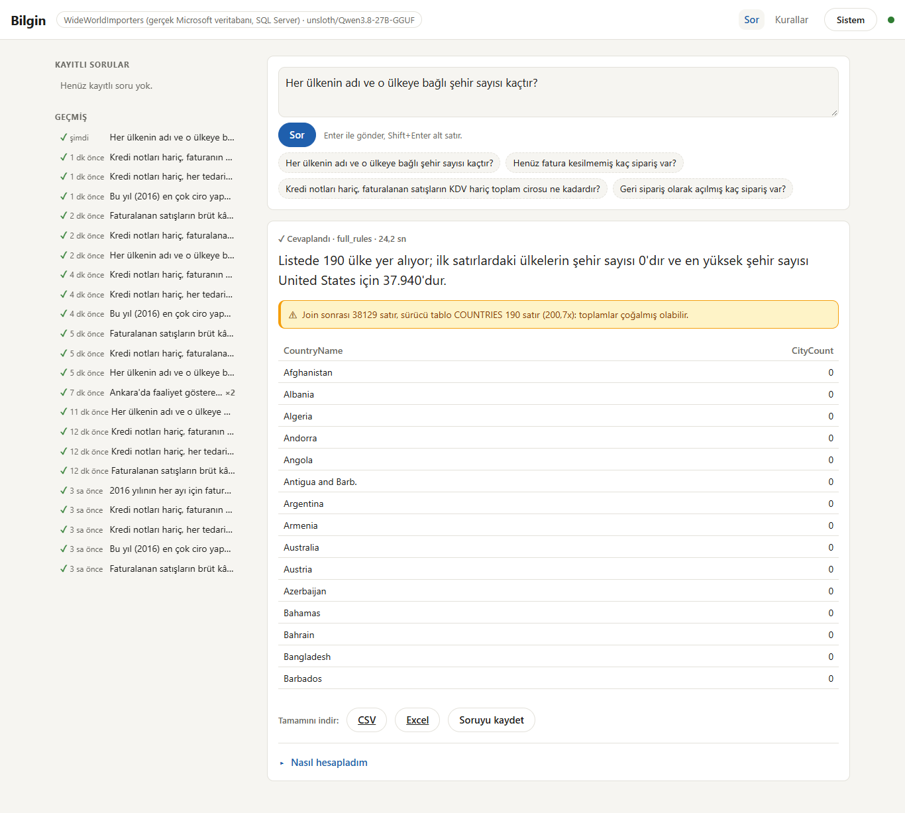 |

#### Q03 · Kredi notları hariç, faturalanan satışların KDV hariç toplam cirosu ne kadardır?

| Model | Modelin döndürdüğü cümle | Süre | Ekran görüntüsü |
|---|---|---|---|
| Flash-Next | Kredi notları hariç faturalanan satışların KDV hariç toplam cirosu 172.261.341,2 olarak görünüyor. | 7.3 sn | 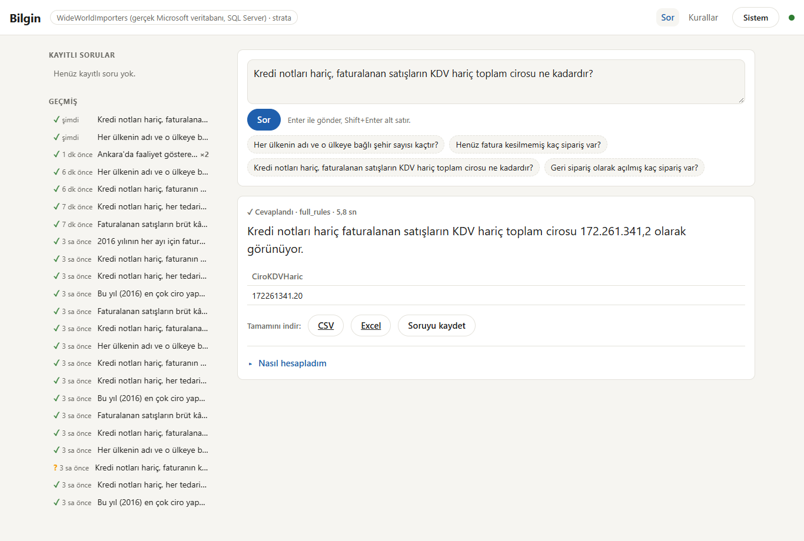 |
| Qwen3.8-27B 24K | Kredi notları hariç faturalanan satışların KDV hariç toplam cirosu 172.261.341,2'dir. | 8.8 sn | 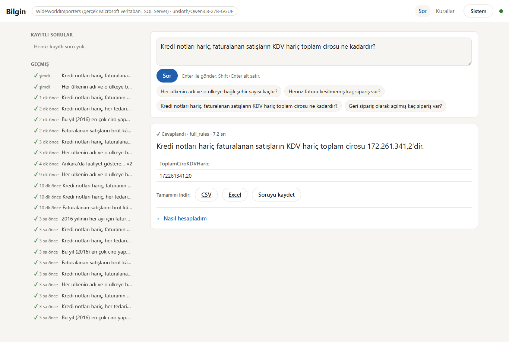 |
| Qwen3.8-27B 16K | Kredi notları hariç faturalanan satışların KDV hariç toplam cirosu 172.261.341,2'dir. | 9.8 sn | 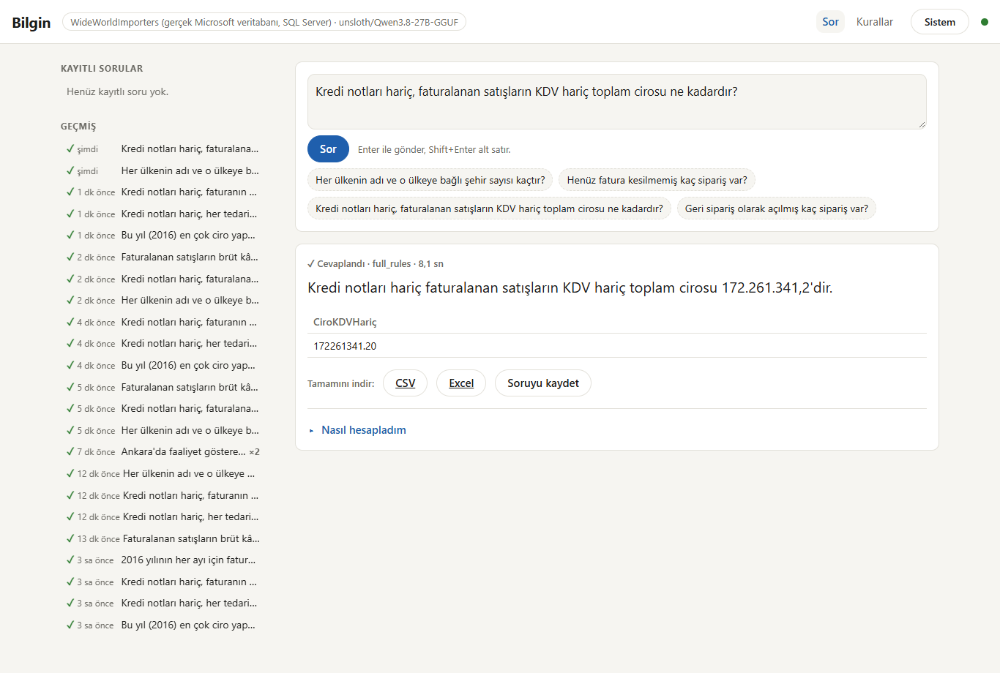 |

#### Q09 · Faturalanan satışların brüt kârı (satır kârlarının toplamı) ne kadardır?

| Model | Modelin döndürdüğü cümle | Süre | Ekran görüntüsü |
|---|---|---|---|
| Flash-Next | Faturalanan satışların brüt kârı 85.729.180,9 olarak listeleniyor. | 11.4 sn | 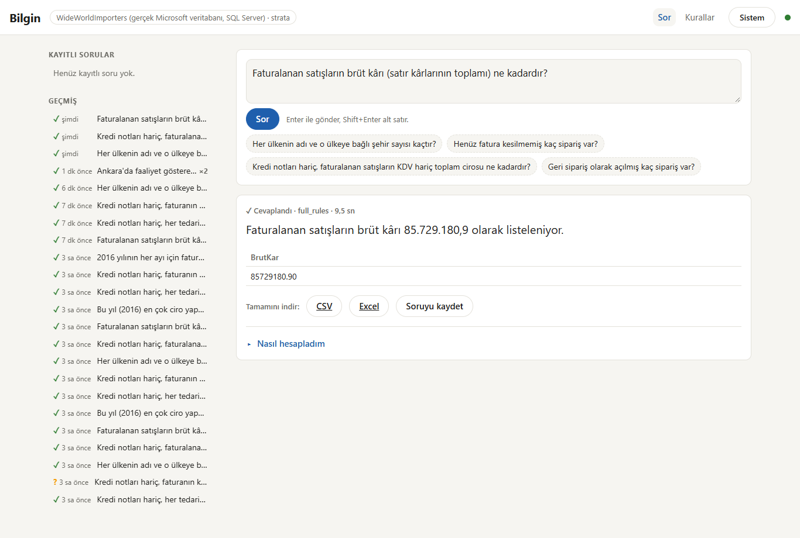 |
| Qwen3.8-27B 24K | Faturalanan satışların brüt kârı 85.729.180,9'dur. | 9.8 sn | 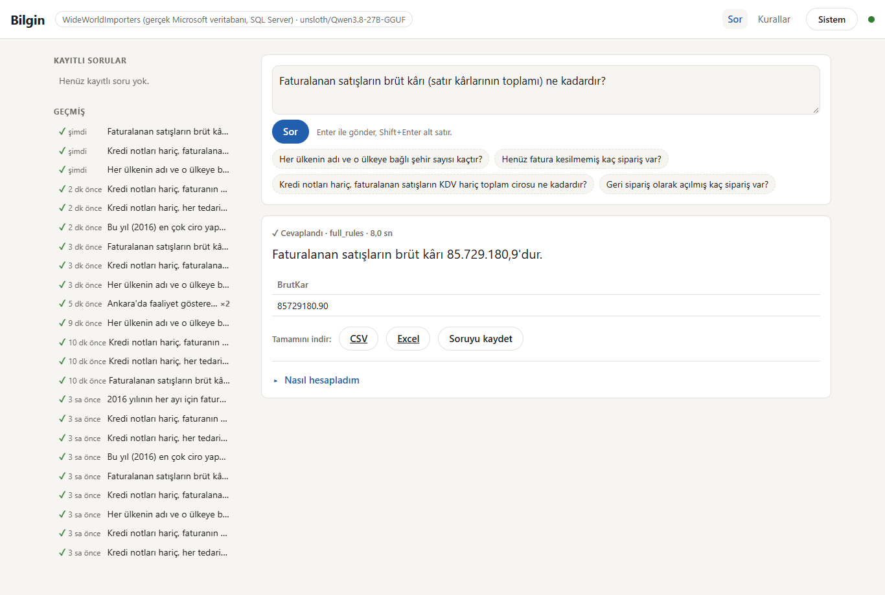 |
| Qwen3.8-27B 16K | Faturalanan satışların satır kârlarının toplamı 85.729.180,9 olarak görünüyor. | 10.3 sn |  |

#### Q12 · Bu yıl (2016) en çok ciro yapan 5 stok kalemi; adı ve cirosu (kredi notları hariç) nedir?

| Model | Modelin döndürdüğü cümle | Süre | Ekran görüntüsü |
|---|---|---|---|
| Flash-Next | Bu yıl en çok ciro yapan 5 stok kalemi Air cushion machine (Blue) 1.441.341, 10 mm Anti static bubble wrap (Blue) 50m 946.440, 20 mm Double sided bubble wrap 50m 853.200, 32 mm Anti static bubble wrap (Blue) 50m 750.750 ve 32 mm Double sided bubble wrap 50m 744.800 olarak sıralandı. | 24.4 sn | 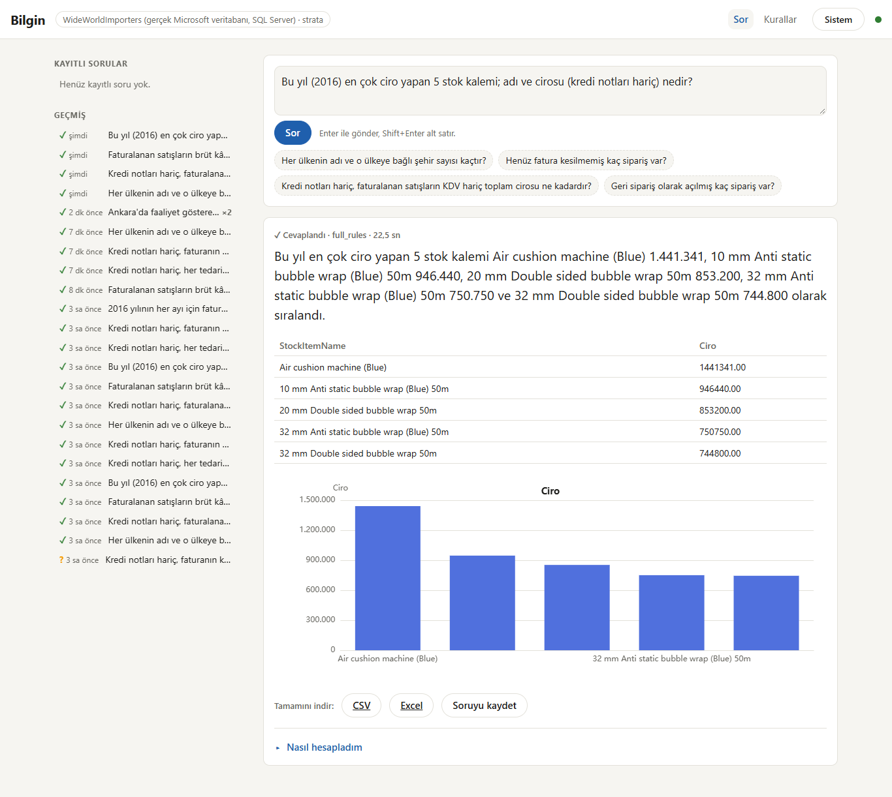 |
| Qwen3.8-27B 24K | 2016'da en çok ciro yapan 5 stok kalemi ve ciroları Air cushion machine (Blue) 1.441.341, 10 mm Anti static bubble wrap (Blue) 50m 946.440, 20 mm Double sided bubble wrap 50m 853.200, 32 mm Anti static bubble wrap (Blue) 50m 750.750 ve 32 mm Double sided bubble wrap 50m 744.800'dur. | 17.9 sn | 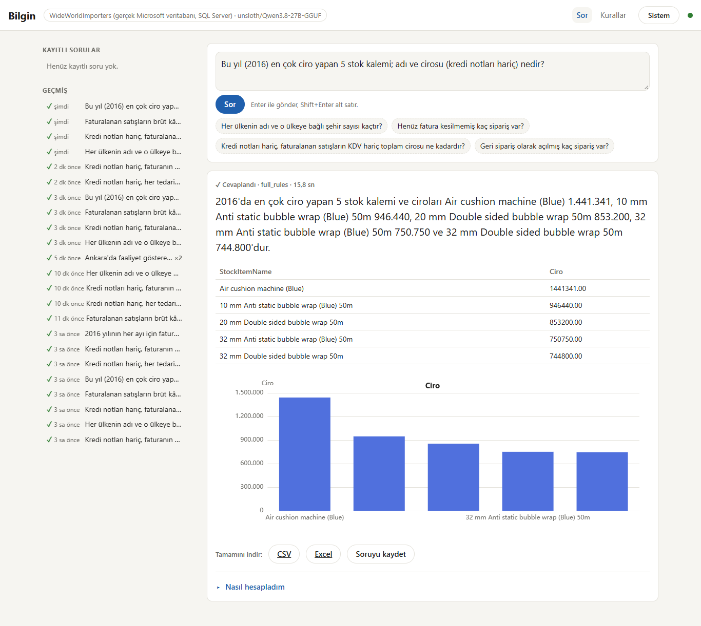 |
| Qwen3.8-27B 16K | En çok ciro yapan 5 stok kalemi Air cushion machine (Blue) 1.441.341, 10 mm Anti static bubble wrap (Blue) 50m 946.440, 20 mm Double sided bubble wrap 50m 853.200, 32 mm Anti static bubble wrap (Blue) 50m 750.750 ve 32 mm Double sided bubble wrap 50m 744.800 oldu. | 50.0 sn | 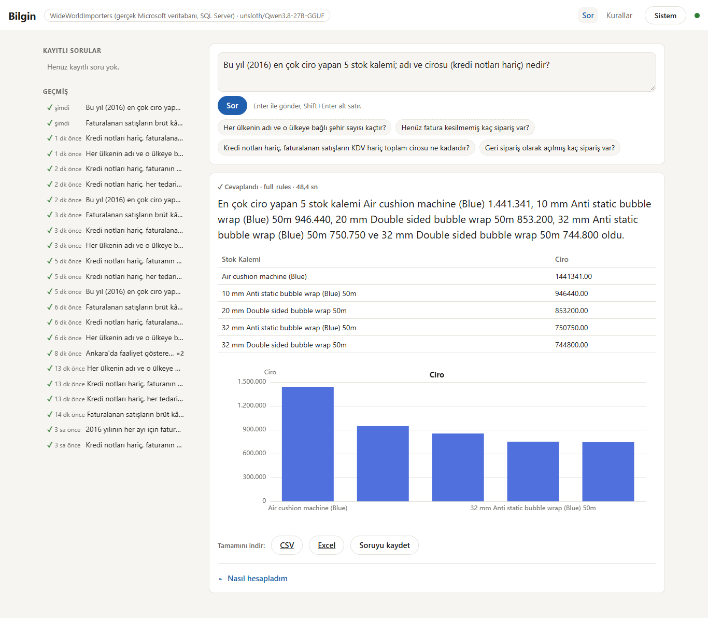 |

#### Q19 · Kredi notları hariç, her tedarikçinin ürünlerinden elde edilen toplam ciro tedarikçi adına göre nedir?

| Model | Modelin döndürdüğü cümle | Süre | Ekran görüntüsü |
|---|---|---|---|
| Flash-Next | Yedi tedarikçinin ürünlerinden elde edilen toplam ciro; Litware, Inc. için 100.664.171,55, Fabrikam, Inc. için 46.441.244, Northwind Electric Cars için 14.802.215, The Phone Company için 5.763.945,45, Graphic Design Institute için 3.172.130, A Datum Corporation için 1.142.515,2 ve Contoso, Ltd. için 275.120'dir. | 15.9 sn |  |
| Qwen3.8-27B 24K | Kredi notları hariç tutulduğunda tedarikçi başına toplam ciro şöyle görünüyor: Litware, Inc. 100.664.171,55; Fabrikam, Inc. 46.441.244; Northwind Electric Cars 14.802.215; The Phone Company 5.763.945,45; Graphic Design Institute 3.172.130; A Datum Corporation 1.142.515,2 ve Contoso, Ltd. 275.120. | 18.4 sn | 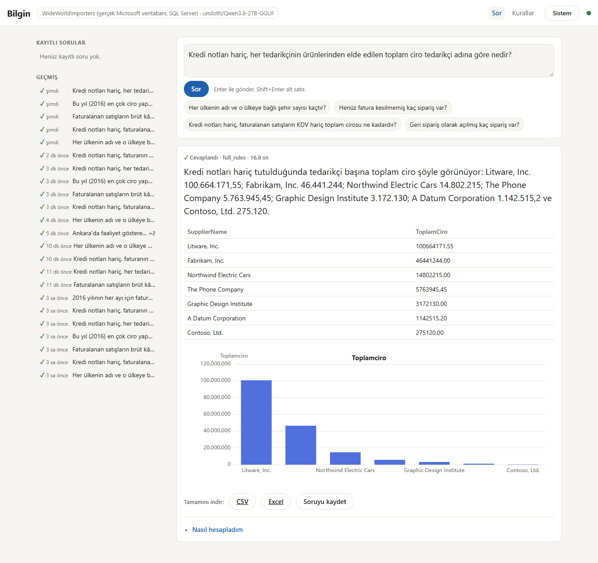 |
| Qwen3.8-27B 16K | Kredi notları hariç tedarikçilere göre toplam cirolar Litware, Inc. için 100.664.171,55, Fabrikam, Inc. için 46.441.244, Northwind Electric Cars için 14.802.215, The Phone Company için 5.763.945,45, Graphic Design Institute için 3.172.130, A Datum Corporation için 1.142.515,2 ve Contoso, Ltd. için 275.120 olmaktadır. | 24.4 sn | 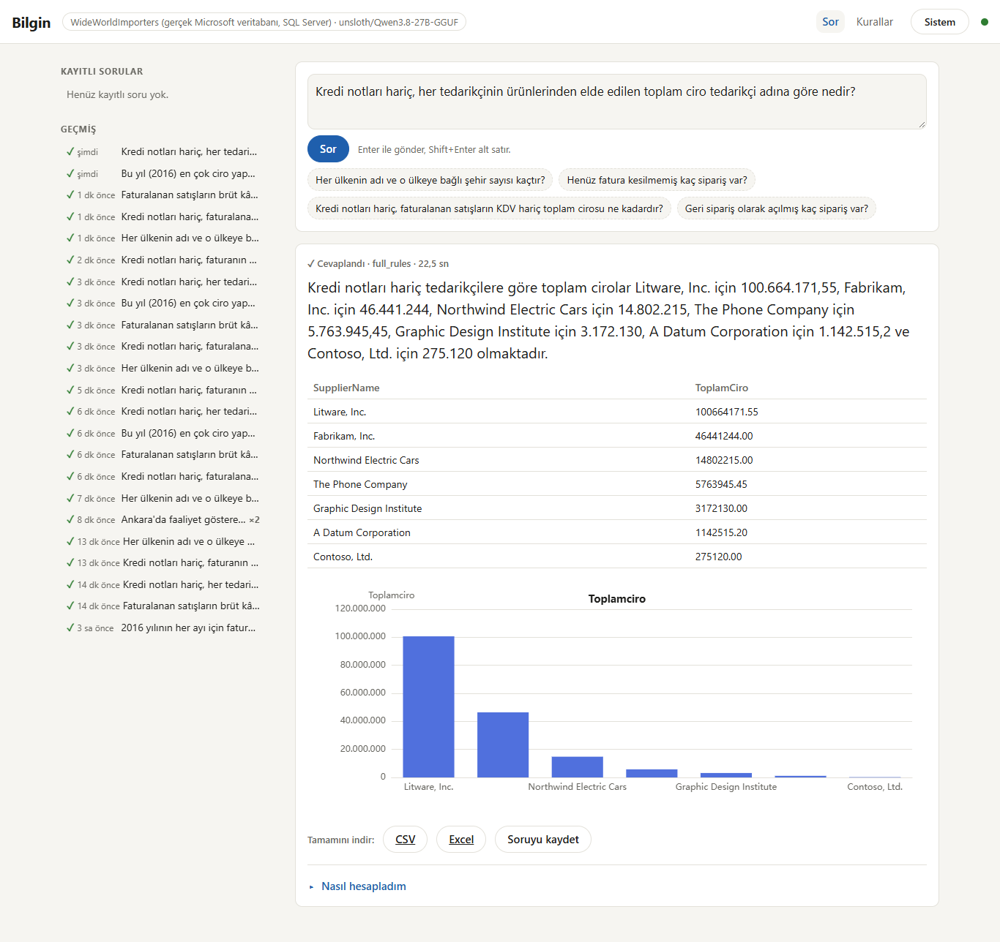 |

#### Q25 · Kredi notları hariç, faturanın kesildiği müşterinin teslimat şehrinin eyaletine göre toplam ciro nedir?

| Model | Modelin döndürdüğü cümle | Süre | Ekran görüntüsü |
|---|---|---|---|
| Flash-Next | Kredi notları hariç, teslimat şehrinin eyaletine göre toplam ciro 172.261.341,2 olarak 49 eyalette oluşuyor. En yüksek ciro 11.957.764,15 ile Texas'a aitken en düşük ciro 316.857,85 ve ortalama ciro 3.515.537,58. | 22.4 sn | 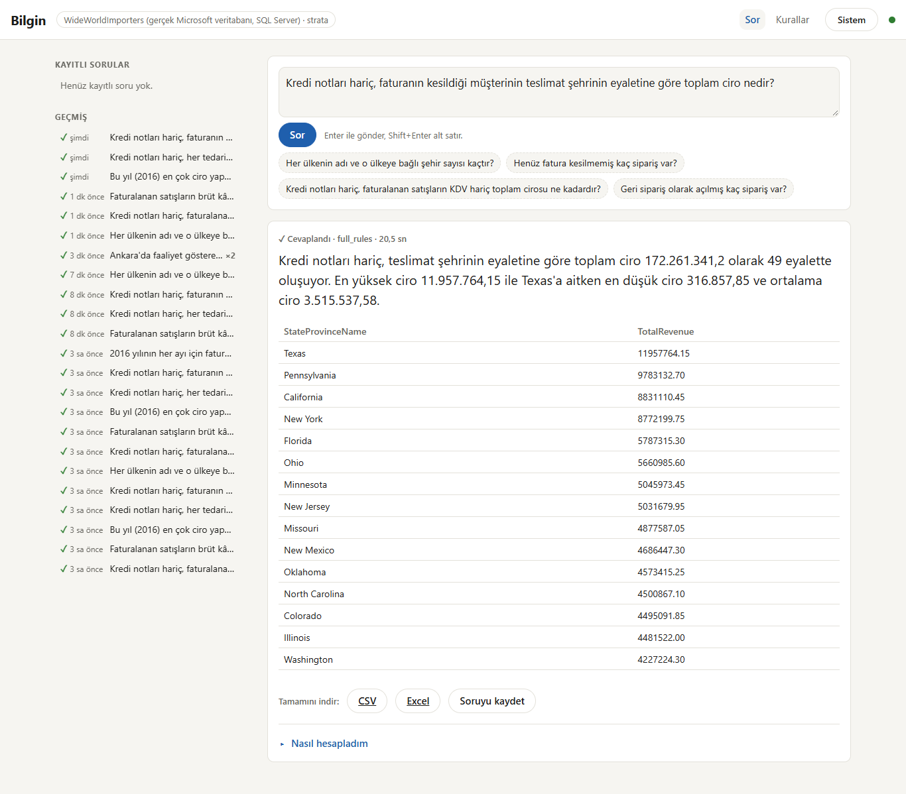 |
| Qwen3.8-27B 24K | Kredi notları hariç tutulduğunda, faturanın kesildiği müşterinin teslimat şehrinin eyaletine göre toplam ciro 49 kayıt için 172.261.341,2 olarak görünüyor. En yüksek toplam ciro Texas'ta 11.957.764,15. | 22.9 sn | 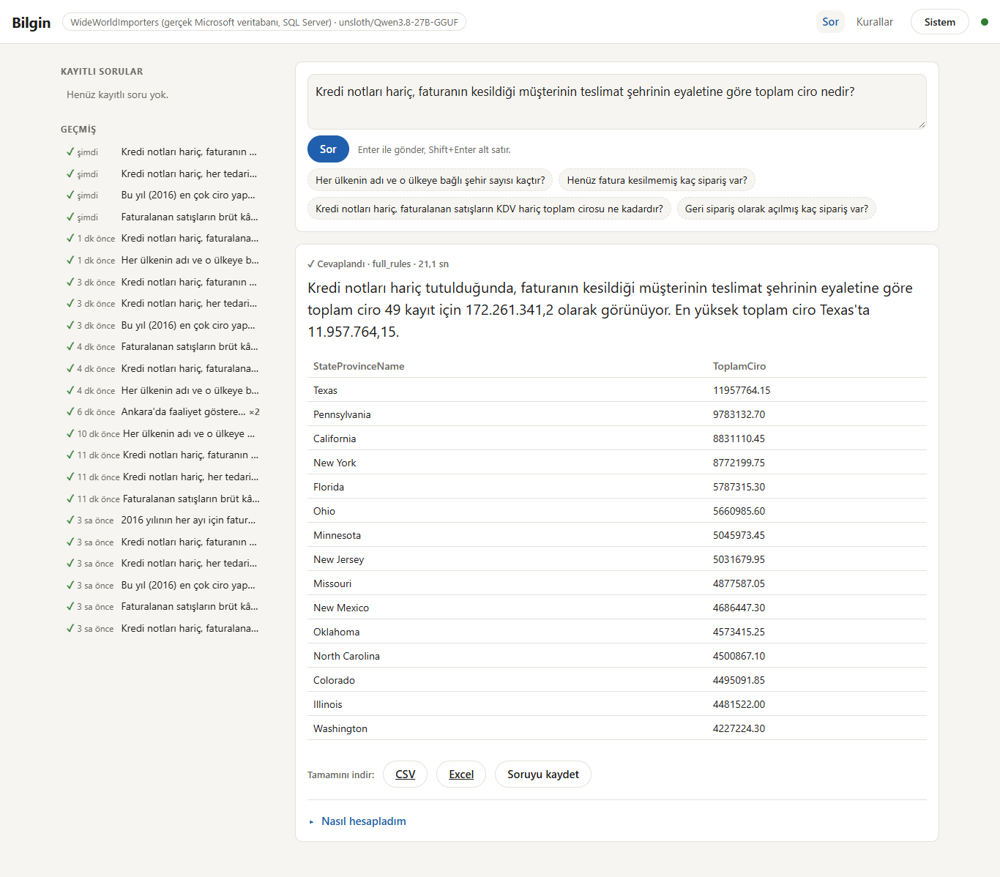 |
| Qwen3.8-27B 16K | Kredi notları hariç, faturanın kesildiği müşterinin teslimat şehrinin eyaletine göre toplam ciroda Texas 11.957.764,15 ile en yüksek değere sahip, Pennsylvania 9.783.132,7 ve California 8.831.110,45 ile onu izliyor. Genel toplam 172.261.341,2 olarak görünüyor. | 29.9 sn | 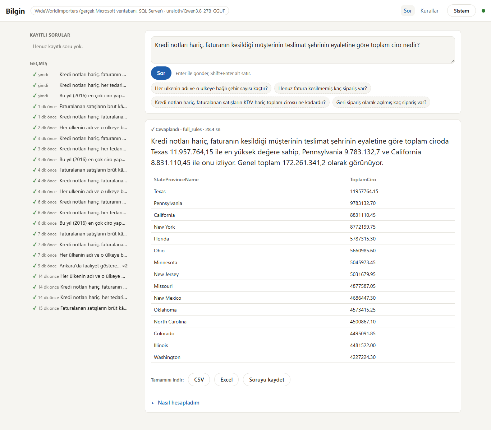 |

**Notlar (gizlenmedi):**

- **Q01:** üç kartta da arayüzün kendi fan-out uyarısı duruyor — "Join sonrası 38129 satır, sürücü tablo COUNTRIES
  190 satır (200,7x): toplamlar çoğalmış olabilir." Sayı doğru (37.940, elle doğrulandı) ama altın cevap tek satır
  isterken 190 satır dönüyor — soru belirsizliği, düzeltme listesinde.
- **Q25:** üçü de aynı yanlış birleşim yolunda ısrar ediyor (Texas 11.957.764,15; elle doğrulanan altın yolun
  lideri Colorado 55.448.401,3 değil). Soru BillToCustomerID ile netleştirilince Flash-Next altın cevapla aynı
  sonucu veriyor — yani sorun sorunun belirsizliğinde, modelin yeteneğinde değil.
- **Cümle kalitesi (cc93633 sonrası):** 18 cümlenin hiçbirinde teknik kolon adı yok; eski koşudaki
  "ToplamCiro / StateProvinceName / TotalRevenue" kaçakları ve 16K'nın jenerik "Satır sayısı X. Toplam Y." kalıbı
  görünmüyor. Anlatım düzeltmesi sonrası süreler de kısaldı (ör. Q19 16K: 43.4 → 24.4 sn).
- Eski 7.2 tablosu (sentetik WWI kopyası, `img/shots/`) geçersizdir; gerçek DB ölçümü yukarıdaki yerini aldı.

## 8. Yol haritası

Öncelik (25 Ekim öğleden sonra): gerçek veritabanı testi **yapıldı** — WideWorldImporters restore edildi,
salt-okunur login ile üç model × iki mod ölçüldü ve iki altyapı hatası bulundu/düzeltildi (`78c98ad`);
ayrıntı `docs/GERCEK-WWI-TEST.md`. Sırada:

1. **Altın cevap netleştirme (Q01, Q25):** Q01 "en az bir şehri olan ülkeler" diye netleştirilecek (ya da altın
   cevap sıfırlı olacak); Q25'in iki meşru yolu (fatura müşterisi vs sipariş müşterisi) ayrı sorular yapılacak —
   Flash-Next'in netleştirme kartındaki iki seçenek kullanılabilir. Hedef: gerçek DB'de 26/26.
2. **Cümle kalitesi:** kolon adı sızıntısı (TotalRevenue, CityCount, StateProvinceName) ve "Satır sayısı X. Toplam
   Y." jenerik kalıbı rapor prompt'unda toplanacak; kullanıcıya kolon adı değil Türkçe terim gösterilmeli.
3. **Eren'in demo veritabanı testi (asıl sınav):** read-only login, dolu demo ERP veritabanı, Eren'in 20-30
   sorusu; Excel açıklamalarının katkısı `eval --schema skeleton` ile ölçülür. ERP şeması WWI'ın birkaç katı —
   `full_rules` sığmazsa rag geçişinin gerçek testi bu olur.
4. **Altın soru incelemesi (Eren):** 40 sentetik sorunun niyeti ve iş tanımları.
5. **Retrieval:** tablo özetleri aramaya katıldı (ölçüm `eval/SUMMARIES.md`); recall@5 gerçek embedding ile yeniden
   ölçülür, embedding kararı (bge-m3) bu ölçümle verilir.
6. **Public yayın:** iş sözleşmesi (rekabet/IP) kontrolü tamamlanana kadar bekliyor → AGPL-3.0, sonuçlar
   WideWorldImporters üzerinde, ERP'e ait hiçbir şey yok (`docs/PUBLIC-RELEASE-PLAN.md`).
7. **Odoo profili ve demosu (geri planda):** PostgreSQL desteği gerektirir; kod tarafında engel yok, sıra bekliyor.
8. **Topoloji C (sonra):** LLM kutusu + müşteri tarafında read-only runner ("o kutu senin DB'ne bağlanamaz").

## 9. Konumlandırma

**Bilgin bir BI ürünü değil; ERP için yerel AI veri analistidir.** BI'ın yerine geçmez, ERP'nin yanına takılır.

- **Hedef kitle:** BI ekibi olmayan şirketler. Patron, finans müdürü, satış ve depo sorumlusu.
- **Fark:** veri dışarı çıkmaz · ERP'yi ve iş kurallarını bilir · Türkçe · dakikalar içinde kurulur.
- **Kanal:** ERP iş ortakları ve danışmanlık projelerine eklenti.

## 10. Riskler

| Risk | Önlem |
|---|---|
| Yanlış ama hatasız sonuç | İş kuralları, join grafiği, SQL ve kullanılan tablolar her zaman gösterilir, altın setle sürekli ölçüm |
| Gerçek şemada doğruluk düşer | Excel açıklamaları + iş kuralları; `eval --schema skeleton` ile açıklamaların katkısı ölçülür |
| Ağır sorgu ERP'yi yavaşlatır | Timeout, `TOP`, read-only replika / AG secondary önerisi, RCSI kontrolü |
| Kişisel veri sızıntısı | DB `DENY` + lineage maskeleme + filtre yasağı + atlatma test seti |
| İşveren sözleşmesi (rekabet / IP) | ERP/Logo tarafında satıştan önce sözleşme okunur; ilk pazar Odoo |
| Marka | "BusAIness Bilgin" olarak ana marka altında tescil; TÜBİTAK "Bilge" ile karışma riski kontrol edilecek |
| Donanım maliyeti | Mod otomatik seçimi; 16 / 24 / 32 GB kademeleri eval ile doğrulanır |

## 11. Açık kararlar

- Lisans modeli: kurulum başına mı, kullanıcı başına mı, abonelik mi?
- İlk müşteri profili ve LLM kutusunun kimin olacağı (müşteri donanımı mı, Bilgin kutusu mu).
- **Müşteri kutusunun varsayılanı (model + mod + pencere):** gerçek WWI ölçümü kararı basitleştirdi (7.1): üç
  modelin `full_rules` skoru aynı (24.0/26), pencere farkı yok (16K yeterli), rag'ın doğruluk bedeli 27B'de −1
  soru. Öneri: **27B + 16K + `full_rules`**; kesin karar Eren'in demo veritabanı testiyle (ERP şeması büyükse
  `full_rules` sığmayabilir ve rag'ın 27B kaybı önce kapatılmalı).
- **Public yayın zamanı:** iş sözleşmesi (rekabet/IP) kontrolü bitmeden yok (bkz. bölüm 8).
- **Odoo'nun sırası:** geri planda bekliyor; PostgreSQL desteği işi ne zaman alınacak?
- Embedding: EmbeddingGemma (geliştirme) yerine bge-m3 (MIT, ürün hedefi). Retrieval ölçümüyle karar verilecek.
- Python paket adı `bilgin` mı kalacak, `bilgin` mi olacak.
